# Guion de la presentación: Qué hace el sitio y qué es una red

Image Bio Pro · Presentación del sistema

Ritmo de lectura considerado: **250 palabras por minuto**. Solo cuentan como palabras las frases que se dicen en voz alta; las indicaciones entre corchetes (pantalla y acciones) no se cuentan.

## Resumen de tiempos

| Tema | Meta | Palabras (meta) | Palabras escritas | Minutos de lectura |
|---|---|---|---|---|
| 1. Introducción | - | - | 1,378 | 5.5 |
| 2. El sitio web en funcionamiento | - | - | 6,431 | 25.7 |
| 3. ¿Qué es una red neuronal? | - | - | 11,663 | 46.7 |
| **Total** | - | - | **19,472** | **77.9** |

Después del contenido hay un espacio de preguntas y comentarios.

## Notas para quien presenta

Estas notas no se leen en voz alta. Son puntos que conviene resolver o comprobar antes de la sesión.

Diapositivas. Las indicaciones en rojo, con el formato [Diapositiva N · título], marcan en qué momento se pasa a cada diapositiva. N es su posición en la presentación. Cuando la indicación aparece a la mitad de un párrafo, se cambia de diapositiva al llegar a ese punto del texto. En la demostración (tema 2) las diapositivas se usan solo en los momentos indicados; el resto del tiempo se trabaja en el navegador.

1. Demostración en vivo. El guion supone que el análisis termina en menos de un minuto. En una computadora de escritorio, una foto de fluorescencia de 1792 px tardó unos 40 s; en el VPS no se ha medido. Conviene ensayar en el servidor real y, si tarda mucho, tener preparado un análisis ya hecho en "Mis análisis" para abrirlo.
2. Lote de tres imágenes (sección "Un lote de varias imágenes y los dos modelos"). Preparar con anticipación dos fotos de fluorescencia y una de fondo claro. Las imágenes de entrenamiento no se suben al repositorio; usar las copias locales.
3. Escala. El guion la presenta como escala de referencia (60 px = 1 µm).
4. Enfoque. Por indicación del cliente, el guion presenta el sistema como terminado y las limitaciones como retos. No afirma nada que no exista: las medidas de cabeza a cola, la calibración de la escala y el aviso de imagen ajena a la muestra aparecen como retos del modelo. Ojo: el sitio en pantalla todavía muestra los recuadros «modelo preliminar» y «escala provisional»; el guion los llama avisos de contexto, pero si se quiere un lenguaje uniforme conviene ajustar también esos textos en el sitio.
5. Datos del entrenamiento. Las cifras (4 fotos y 258 etiquetas en fluorescencia; 4 fotos y 45 en fondo claro; 85 de cada 100 en zonas amontonadas; conteos 114, 9, 2, 1 y 43) salen de docs/integracion-modelos.md. Si cambian los modelos, revisar las secciones de alcance, de los dos modelos y de transferencia.
6. COCO. Las cifras del conjunto de referencia (más de 300 mil fotografías, más de un millón de objetos, ochenta categorías) son de conocimiento general, no del repositorio. Verificarlas si se quiere citarlas con exactitud.
7. Ejemplos con números. Los de "Un ejemplo de lectura de resultados" son inventados y así se dicen en voz alta. El ciclo con un solo peso se puede comprobar con una calculadora.
8. Tono. El cliente pidió lenguaje profesional y sin comentarios que sugieran que el grupo no sabe. Hay dos perfiles con mucha experiencia; si el ritmo se siente lento, saltar los ejemplos numéricos de neurona y de convolución.

---

## Tema 1. Introducción

*1,378 palabras · 5.5 min a 250 palabras por minuto*

### 1.1 Bienvenida y propósito de la sesión

*28 palabras · 0.1 min*

[Diapositiva 1 · Image Bio Pro]

Buenas tardes a todos, y gracias por conectarse. Mi nombre es Angel Frausto Robles, desarrollador de Image Bio Pro.

Empecemos por lo básico: para qué existe este proyecto.

### 1.2 Objetivo del proyecto

*369 palabras · 1.5 min*

[Diapositiva 2 · Una fotografía entra; contornos y datos salen]

Image Bio Pro es un sitio web bilingüe, en español y en inglés, que analiza imágenes de microscopía de fluorescencia de espermatozoides. El usuario sube una fotografía y el sistema detecta cada espermatozoide, lo cuenta, mide su tamaño y dibuja la distribución de esos tamaños en una gráfica. Los resultados se pueden descargar de dos maneras: un archivo CSV, para seguir trabajando con los datos en una hoja de cálculo o en código propio, y un informe en PDF.

[Diapositiva 3 · Contar y medir a mano]

El proyecto nace de una necesidad concreta. Contar y medir células a mano es lento, repetitivo y cambia según quién lo haga. Una sola fotografía puede tener decenas o cientos de células, muchas encimadas o pegadas unas a otras. Si además hay que comparar muchas imágenes, el trabajo manual se vuelve difícil de sostener. La propuesta es que una red neuronal haga la primera parte, que es localizar, y que lo demás (las mediciones y la estadística) se calcule con procedimientos explícitos que cualquiera pueda verificar.

[Diapositiva 4 · La red localiza y el código mide]

Esta división de tareas atraviesa todo el diseño, así que la explico con calma. La red neuronal tiene un solo trabajo: decidir dónde hay un espermatozoide y trazar su contorno. Todo lo demás sale de código convencional, con OpenCV y numpy, a partir de esos contornos: cuántos son, cuánto mide el área de cada uno, cuánto mide su largo, la media y la desviación estándar. En la práctica, si alguien quiere comprobar un resultado, abre la imagen marcada, mira el contorno que trazó la red y recalcula la medida por su cuenta. La red hace una propuesta, y la medición se puede auditar.

Un modelo así no aprende solo una vez que está en línea. Si llegan imágenes nuevas, otras tinciones u otro tipo de célula, se reentrena aparte y se cambia el archivo del modelo.

Dicho en una frase, el objetivo es un sitio que convierta una fotografía de microscopio en datos descargables y confiables.

[Diapositiva 5 · Una parte web y una de aprendizaje automático]

Para terminar este bloque, qué tipo de trabajo es este: un sistema con una parte web, que se mantiene como cualquier sitio, y una parte de aprendizaje automático, que se mejora con datos. Cada una necesita cuidados distintos, y las dos están documentadas en el repositorio del proyecto.

### 1.3 Alcance del sistema

*445 palabras · 1.8 min*

Paso a lo que hace el sitio, que divido en dos partes: la parte informativa y el análisis de imágenes.

[Diapositiva 6 · Un menú desplegable con seis secciones]

Empiezo por el sitio. Tiene un menú desplegable, de los que llaman de hamburguesa, con las secciones Inicio, Nosotros, Aliados, Infografías y videos, Inteligencia Artificial y Contacto. Hay un selector de idioma, español e inglés, y la traducción del contenido la resuelve el traductor de Google. Nosotros explica qué es Image Bio Pro. Aliados muestra a las personas del grupo con nombre y foto. Contacto tiene el formulario clásico con nombre, correo y mensaje. Las infografías funcionan como un blog: al hacer clic en una se abre una ventana con la imagen y su texto. Debajo van unos cuatro videos cortos. El estilo es sencillo y funcional, como se pidió.

[Diapositiva 7 · Del inicio de sesión a la descarga]

Sigo con el análisis de imágenes, que es el corazón del proyecto. El usuario crea una cuenta con su correo y una contraseña. El sitio se puede recorrer sin cuenta, pero para analizar imágenes hay que iniciar sesión. Se pueden subir hasta diez imágenes a la vez. De cada una, el sistema detecta los espermatozoides, los cuenta, mide el área y el largo de cada uno, y calcula la media y la desviación estándar. Genera una gráfica de distribución de tamaños por imagen y, cuando se suben varias, una gráfica adicional con los promedios. Mientras corre el análisis aparece una barra de progreso, y al terminar los resultados se muestran en pantalla y se descargan en CSV y en un solo PDF que reúne todas las imágenes.

Cada usuario tiene una sección llamada Mis análisis, donde puede volver a ver los que hizo. Son privados: solo los ve quien los hizo. Las imágenes que se suben se borran al terminar el análisis. Lo que se conserva es el PDF y una copia reducida con los espermatozoides marcados.

También hay un botón para analizar una imagen de ejemplo incluida en el sitio, de modo que cualquiera pueda ver el flujo completo sin subir una propia. Es una imagen sintética, generada para ese fin.

[Diapositiva 8 · Entrenamiento aparte, inferencia en el servidor]

Dos precisiones más. El sistema trabaja con las fotografías de fluorescencia de espermatozoides que el grupo ha compartido; no pretende ser un analizador general de células. Y el servidor solo hace inferencia, es decir, usa el modelo ya entrenado, y lo hace en procesador. El entrenamiento ocurre aparte, en Google Colab.

Una última cosa sobre el alcance, que se suele pasar por alto: el sitio no interpreta los resultados. Entrega conteos, medidas y gráficas, y la lectura científica de esos números corresponde al grupo. No compara con valores de referencia ni dice si un tamaño es normal o no. Esa decisión fue deliberada.

### 1.4 Qué incluye el sistema

*342 palabras · 1.4 min*

Veamos qué incluye el sistema. Un sitio completo y en línea, con cuentas, carga de imágenes, análisis, resultados, gráficas, exportación a CSV y PDF, y dos modelos entrenados: uno para fotografías de fondo oscuro, que son las de fluorescencia, y otro para fotografías de fondo claro. El sitio mide el brillo de cada fotografía y elige solo el modelo que le toca.

[Diapositiva 9 · Con poco material y muchas células juntas]

Ahora, los retos del modelo, que son parte natural de cualquier modelo de aprendizaje automático. El primero es el volumen de datos. Los dos modelos se entrenaron con cuatro fotografías en fluorescencia, con 258 espermatozoides etiquetados, y cuatro en fondo claro, con 45. Con ese material funcionan bien en escenas parecidas a las del entrenamiento, y con otras muestras, otras tinciones o imágenes con compresión el resultado puede variar. El segundo es la aglomeración: donde hay muchos espermatozoides juntos, el modelo puede repetir o partir contornos, así que ahí los conteos se leen como estimaciones. El sitio acompaña cada resultado con un aviso de contexto sobre el modelo.

[Diapositiva 10 · La escala en micras y el tiempo de análisis]

Hay además dos aspectos técnicos que se ven en la demostración. El primero es la escala en micras. Las fotografías no traen barra de escala ni regla impresa, y los archivos tampoco guardan esa información; por eso el sitio trabaja con una equivalencia de sesenta píxeles por micra, que sale de una raya de 300 píxeles que equivale a cinco micras. Cada resultado indica la escala que se usó, y la escala se guarda en una tabla que se edita sin tocar el código.

El segundo es el tiempo de análisis. En una computadora de escritorio, sin otros procesos, una fotografía grande de fluorescencia tarda unos cuarenta segundos y una de fondo claro entre diez y veinte. Si se suben varias imágenes, se analizan una tras otra. Dos o tres minutos de espera son aceptables, y el sitio tiene tiempos de espera amplios y una barra de progreso.

El sitio lee toda su configuración del propio archivo del modelo, así que cambiar un modelo por otro más nuevo no requiere tocar código.

### 1.5 Principios con los que se trabajó

*194 palabras · 0.8 min*

[Diapositiva 11 · Tres principios que explican lo que se ve]

Les cuento también los principios con los que trabajé, porque explican varias decisiones que van a ver.

El primero es no suponer. Cuando falta un dato, como la escala de las imágenes o lo que marca cada tinción, el sitio no lo inventa: lo indica en pantalla. Por eso cada resultado señala la escala que se usó y el estado del modelo. Prefiero un aviso claro a un número que parezca más seguro de lo que es.

El segundo es separar lo que decide la red de lo que se mide. Lo mencioné antes y lo repito porque es lo que más pesa en la confianza del sistema: la red localiza y el código mide, así que cualquier medida se verifica sin abrir la red.

El tercero es la reproducibilidad. El entrenamiento está en un cuaderno de Colab que cualquiera puede abrir y ejecutar. El modelo guarda dentro de su propio archivo la configuración con la que se entrenó. Y el servidor se levanta con archivos de configuración versionados. Si hay que repetir un resultado o reconstruir el entorno, no depende de lo que alguien recuerde.

Con esto, pasemos a ver el sitio funcionando.

[Cambiar al navegador.]

## Tema 2. El sitio web en funcionamiento

*6,431 palabras · 25.7 min a 250 palabras por minuto*

### 2.1 Recorrido por el sitio informativo

*477 palabras · 1.9 min*

[Pantalla: navegador con el sitio abierto en la página de inicio, sin sesión iniciada. Zoom del navegador al 125 % para que se lea bien en la videollamada.]

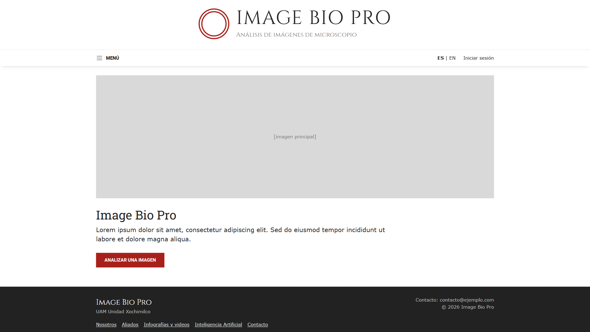

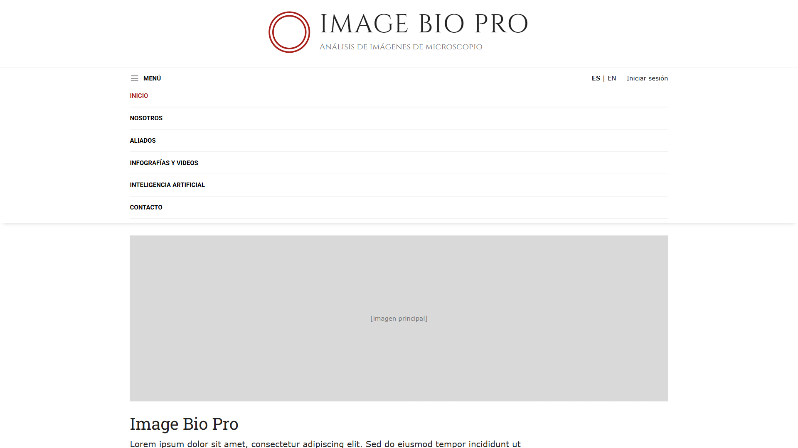

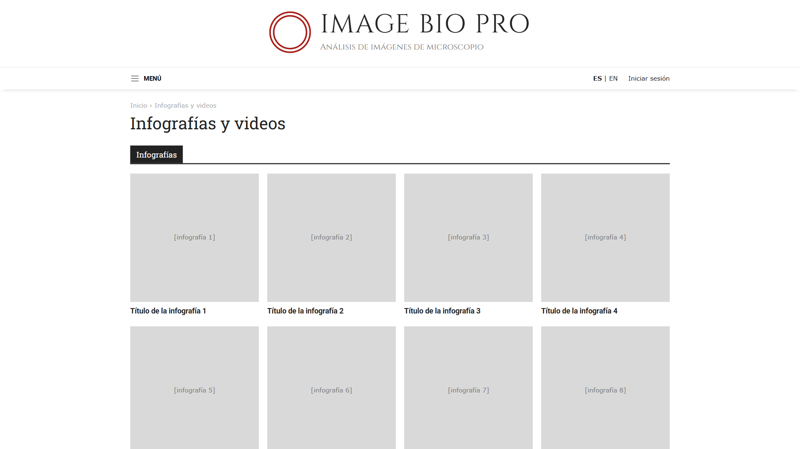

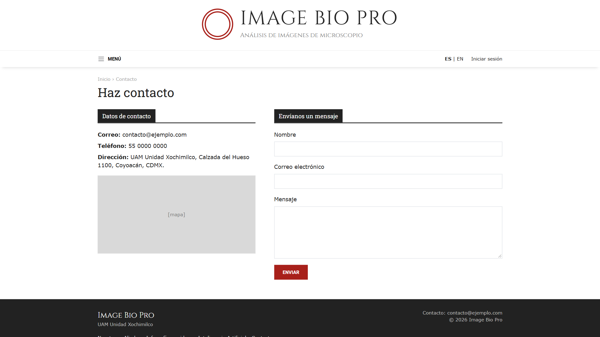

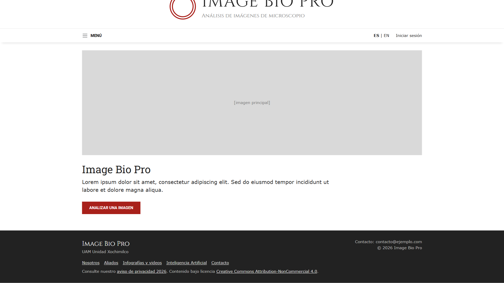

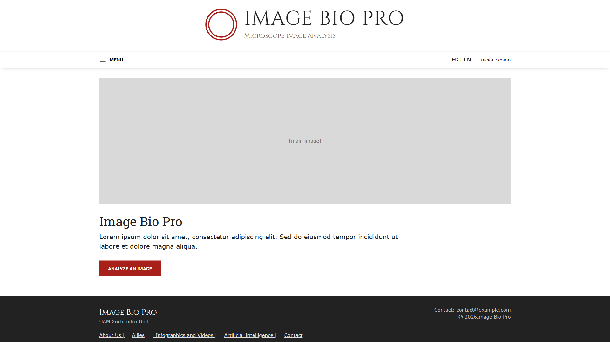

[Diapositiva 12 · El sitio en funcionamiento]

Vamos a ver el sitio funcionando. Lo que tienen en pantalla es la página de inicio de Image Bio Pro. Estoy en el navegador sin haber iniciado sesión, a propósito: quiero que vean primero lo que ve cualquier visitante.

[Diapositiva 13 · La página de inicio, como la ve cualquier visitante]

Arriba aparece el nombre del proyecto con su lema, «Análisis de imágenes de microscopio». Debajo, a la izquierda, está el botón Menú, el de hamburguesa que se pidió en las reuniones. Si hago clic se despliegan las seis secciones: Inicio, Nosotros, Aliados, Infografías y videos, Inteligencia Artificial y Contacto. A la derecha de esa misma barra están el selector de idioma, con ES y EN, y el acceso para iniciar sesión.

La página de inicio es sencilla a propósito. Hay un espacio para una imagen principal, el título, un párrafo de presentación y un botón que dice «Analizar una imagen».

[Diapositiva 14 · Nosotros, Aliados, Infografías y Contacto]

Recorro las secciones rápido. En Nosotros está la explicación de qué es Image Bio Pro. En Aliados hay una tarjeta por persona, con nombre y fotografía. Infografías y videos tiene dos partes. Arriba están las infografías, como cuadros; al hacer clic en uno se abre una ventana grande con la imagen y su texto, igual que en un blog, y el título de cada infografía va fuera de la imagen, como se pidió. Más abajo hay unos cuatro videos de YouTube que se reproducen en la misma página, sin sacar al visitante del sitio. Y Contacto tiene un formulario con nombre, correo y mensaje.

Sobre ese formulario: funciona y guarda cada mensaje en la base de datos del sitio.

[Diapositiva 15 · Idioma y pie de página]

Ahora el selector de idioma. Si hago clic en EN, el sitio completo se traduce al inglés. La traducción la hace el servicio de Google, integrado en la página, así que no mantenemos dos versiones del sitio ni dos juegos de textos. Cuando el grupo cambie un texto en español, la versión en inglés se actualiza sola. A cambio, la calidad es la de un traductor automático, y por eso los nombres propios, como el del proyecto y los nombres de archivo, están marcados para que no se traduzcan. Vuelvo a ES para seguir.

En el pie de página están el nombre del proyecto, la institución, un correo de contacto de ejemplo y los mismos enlaces del menú. Debajo hay dos elementos que el grupo pidió: el aviso de privacidad 2026 y la mención de la licencia Creative Commons Atribución-No Comercial.

[Diapositiva 16 · Un estilo sobrio que se adapta a la pantalla]

El estilo es sobrio, con pocos colores, porque eso se pidió. De otro sitio que el grupo mencionó solo se tomó la estructura, no el diseño. El sitio usa Bootstrap, así que se adapta a distintos tamaños de pantalla: abierto desde un teléfono, el menú y las tarjetas se acomodan solos.

Con eso queda la parte informativa. Lo que sigue es la parte que justifica el proyecto, el análisis de imágenes, y para usarla hace falta una cuenta.

### 2.2 Crear una cuenta e iniciar sesión

*529 palabras · 2.1 min*

[Pantalla: hacer clic en «Iniciar sesión» en la barra superior. Se abre la página «Mi cuenta».]

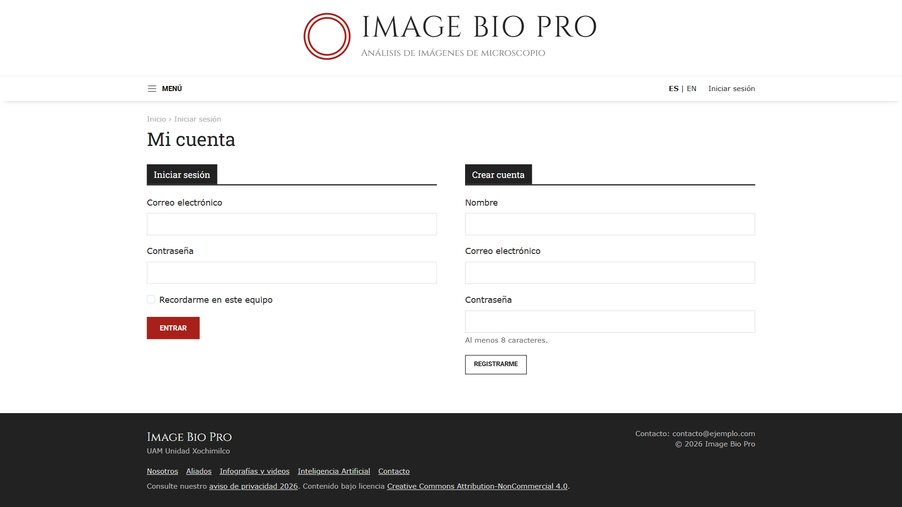

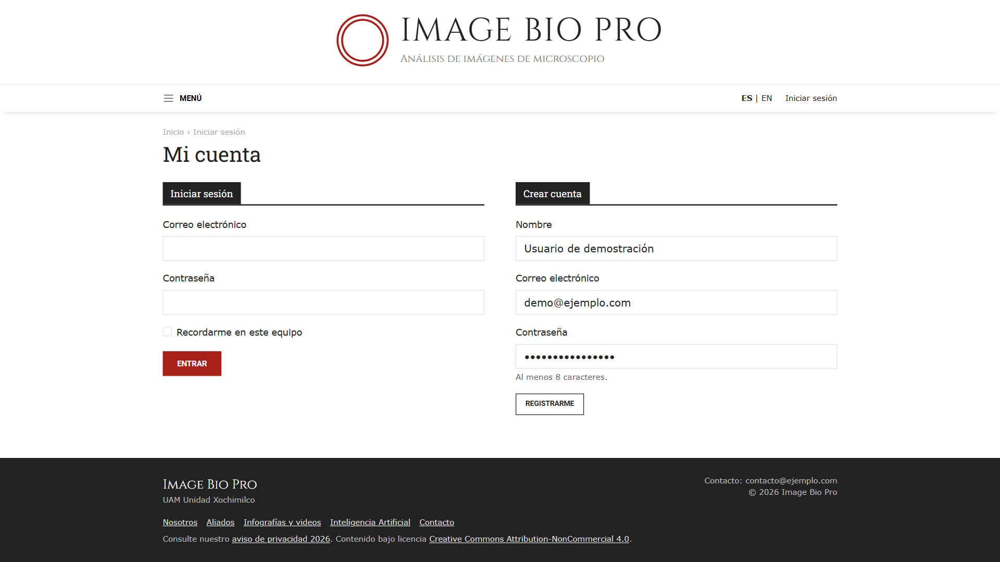

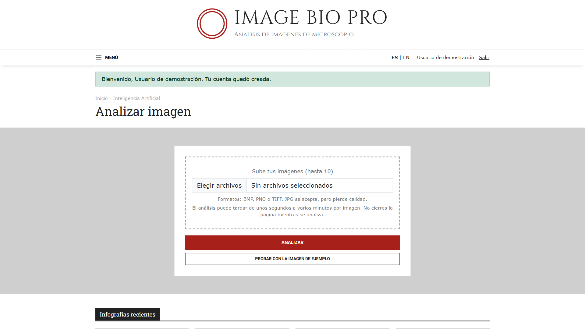

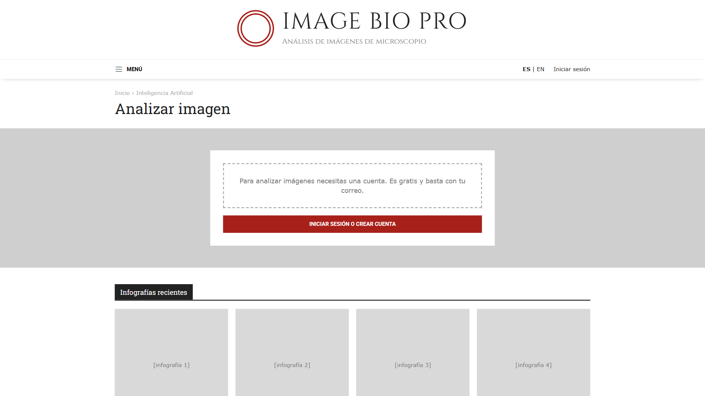

[Diapositiva 17 · «Mi cuenta»: entrar o crear una cuenta]

Hago clic en «Iniciar sesión» y llego a una página titulada «Mi cuenta», con dos columnas. A la izquierda está el formulario para quien ya tiene cuenta, con correo y contraseña. A la derecha, el de cuenta nueva.

Voy a crear una cuenta como lo haría alguien que llega por primera vez. Se piden tres datos. El nombre aparece en los informes y en la parte superior del sitio, así que conviene escribir el de la persona que usará la cuenta. El correo es el identificador para entrar; no tiene que ser de Gmail ni está vinculado a ningún servicio externo. La contraseña debe tener al menos ocho caracteres, como indica la nota debajo del campo.

[Acción: escribir un nombre de ejemplo, un correo de ejemplo y una contraseña de al menos ocho caracteres. Hacer clic en «Registrarme».]

[Diapositiva 18 · Qué revisa el sitio al registrar]

Al hacer clic en «Registrarme», el sitio revisa que los tres campos estén llenos, que el correo tenga formato válido, que la contraseña mida ocho caracteres o más y que no exista ya una cuenta con ese correo. Si algo falla, sale un aviso en amarillo que dice qué corregir. Si todo está bien, la cuenta se crea y la sesión se inicia en el acto. Ven el mensaje verde arriba, «Bienvenido» seguido del nombre, y el nombre ahora aparece en la barra superior junto a «Salir».

Hay tres decisiones de diseño detrás de esto.

[Diapositiva 19 · Tres decisiones de diseño]

La primera: cualquiera puede registrarse sin que un administrador lo apruebe. Así se planteó en las reuniones, como un trámite sencillo. Un panel de administración para aprobar o dar de baja usuarios es una ampliación posible si el grupo lo necesita.

La segunda: las contraseñas. El sitio no guarda la que uno escribe, sino una versión cifrada, calculada con una función de resumen que no se puede invertir. Nadie, ni quien administre el servidor, puede ver la contraseña original. Al iniciar sesión, el sitio calcula otra vez el resumen de lo escrito y compara. Las sesiones las maneja una biblioteca estándar de Flask hecha para eso, para no inventar una parte delicada.

La tercera: la protección de los formularios. Cada uno lleva un código oculto que el servidor verifica al recibirlo, una medida contra la falsificación de peticiones entre sitios. El usuario no la nota, pero evita que otra página envíe formularios a su nombre.

[Acción: hacer clic en «Salir». Mostrar el aviso «Cerraste sesión». Volver a «Iniciar sesión».]

[Diapositiva 20 · Salir, volver a entrar y el aviso de error]

Para mostrar el otro camino, cierro sesión con «Salir». El sitio avisa que cerré sesión y me regresa al inicio. Vuelvo a la página de la cuenta y uso el formulario de la izquierda con el mismo correo y la contraseña. Hay una casilla, «Recordarme en este equipo»: si se marca, la sesión se mantiene aunque se cierre el navegador. Es cómoda en un equipo personal y poco recomendable en uno compartido. Hago clic en «Entrar».

Si escribiera una contraseña incorrecta, el mensaje sería deliberadamente vago: «Correo o contraseña incorrectos». No dice cuál de los dos falló, para que nadie pueda usar el formulario y averiguar qué correos están registrados. Es una práctica habitual de seguridad.

Ya estoy dentro, y el sitio me lleva directo a la página de análisis, que es adonde casi siempre querremos ir. Quien intente entrar a esa página sin sesión recibe la invitación a iniciar sesión o crear una cuenta, y al terminar vuelve al lugar donde iba.

### 2.3 Subir las imágenes y esperar el análisis

*721 palabras · 2.9 min*

[Pantalla: página «Inteligencia Artificial», con el título «Analizar imagen», el recuadro de carga y el botón.]

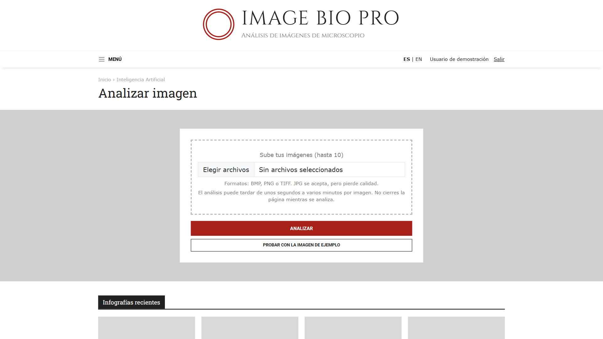

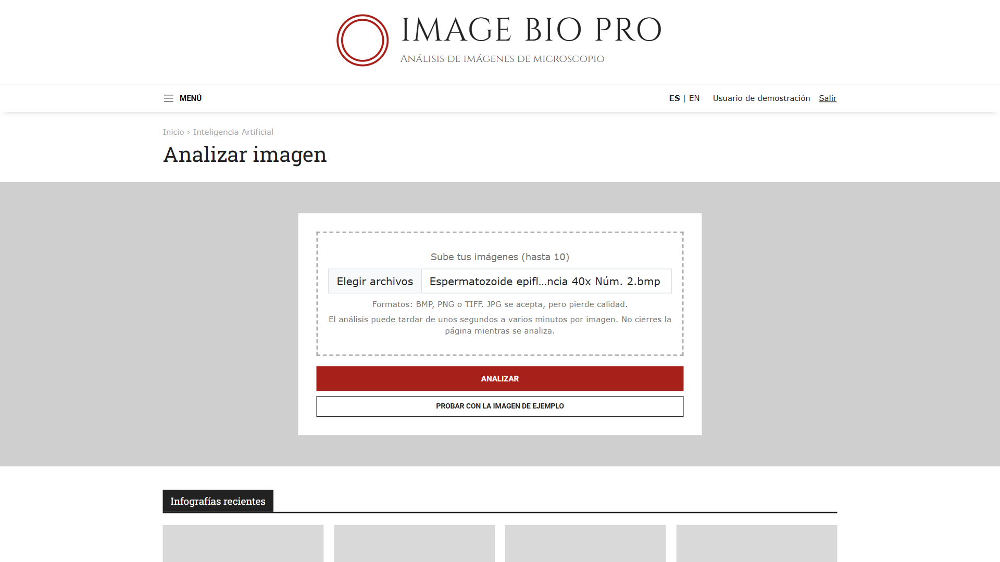

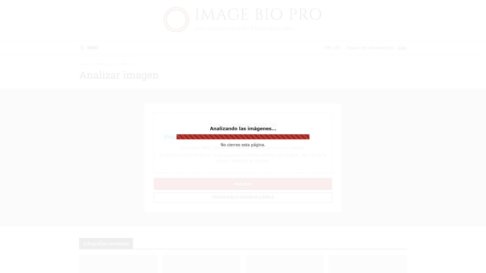

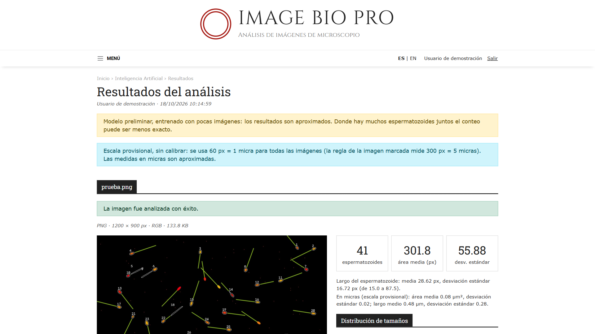

Estamos en la página de Inteligencia Artificial. El título es «Analizar imagen». Hay una zona con imagen de fondo, como se pidió en las reuniones, y dentro de ella un recuadro de carga. Debajo, una sección de infografías recientes que sirve de complemento para que la página no se vea vacía.

[Diapositiva 21 · Un recuadro con lo necesario]

En el recuadro hay solo lo necesario: un campo para elegir archivos, un botón «Analizar» y otro que dice «Probar con la imagen de ejemplo». Nada más. No hay parámetros ajustables ni opciones avanzadas, y es a propósito: en las reuniones se acordó que la interfaz de análisis tuviera únicamente el botón de ejecutar. Así, dos personas que analicen la misma imagen obtienen el mismo resultado, sin depender de una configuración que alguien movió sin querer.

El texto sobre el campo dice: «Sube tus imágenes (hasta 10)». Se pueden subir de una a diez imágenes en una sola operación. Debajo hay una nota sobre los formatos aceptados: BMP, PNG o TIFF, y también JPG, con una advertencia, porque el JPG pierde calidad al comprimirse. Esa advertencia pesa más de lo que parece. En las reuniones se insistió en que las imágenes lleguen con la mayor calidad posible, tal como salen del microscopio y sin pasar por aplicaciones de mensajería, que las comprimen. Una imagen comprimida puede alterar los bordes de las células, y con ellos los contornos y las medidas. Siempre que se pueda, conviene subir los archivos originales.

[Acción: hacer clic en «Probar con la imagen de ejemplo». Si se prefiere mostrar una fotografía real, usar el campo de carga con una de las imágenes preparadas para la demostración.]

Para la demostración uso el botón de la imagen de ejemplo. Es una imagen sintética, generada con un programa pequeño que forma parte del proyecto, y existe para que cualquiera pruebe el sitio completo sin una fotografía propia. En producción se dejará una sola, como se acordó. Más adelante muestro también resultados de una fotografía real, para que vean cómo se comporta con material de verdad.

[Diapositiva 22 · La cubierta de espera]

Al hacer clic aparece una cubierta que dice «Analizando las imágenes…», con una barra de progreso animada y la indicación «No cierres esta página». Es la barra que se pidió, y es una barra de actividad, no de porcentaje. El análisis de una imagen es una sola operación en el servidor, y el navegador recibe el resultado cuando termina. Es una solución simple y robusta: la barra confirma que el sistema está trabajando y que la petición no se perdió.

Mientras esperamos, cuento qué pasa del otro lado. La imagen viajó por internet hasta el servidor, que comprobó que su extensión es una de las permitidas. Luego midió el brillo de la fotografía para saber si es de fondo oscuro o claro, y con eso eligió uno de los dos modelos. Preparó la imagen igual que se prepararon las del entrenamiento, la dividió en recortes pequeños llamados teselas, que se solapan entre sí, y pasó cada tesela por la red. La red devolvió un contorno por cada espermatozoide que encontró. Esos contornos se juntaron, se eliminaron los que quedaron repetidos en las zonas de solape y, al final, se midieron. Todo ocurre en el procesador del servidor, sin tarjeta gráfica.

[Diapositiva 23 · Unos segundos por imagen, y se suman]

Sobre el tiempo. En mi computadora de desarrollo, una fotografía grande de fluorescencia tarda unos cuarenta segundos, y una de fondo claro entre diez y veinte. Si suben diez imágenes, el sistema las analiza una tras otra, así que el tiempo total es la suma. Por eso el sitio tiene tiempos de espera amplios, de hasta media hora, y la nota bajo el campo dice que el análisis puede tardar de unos segundos a varios minutos por imagen. En las reuniones se dijo que dos o tres minutos de espera eran aceptables, incluso deseables por percepción comercial. Si en algún momento el tiempo resultara excesivo, hay dos salidas previstas: limitar el número de imágenes por envío, o pasar el análisis a segundo plano con una página de espera.

Un detalle más: los modelos se cargan en memoria una sola vez, la primera vez que se usan, y no en cada análisis. Por eso el primer análisis después de reiniciar el servidor tarda un poco más que los siguientes. También explica por qué el servidor corre un solo proceso con varios hilos: cada modelo pesa unos ciento setenta y seis megabytes, y con varios procesos se duplicarían en memoria.

[Acción: esperar a que termine el análisis. Si la espera es larga, seguir hablando de lo anterior. Cuando termine, el sitio muestra la página de resultados.]

Ya terminó. El sitio me lleva solo a la página de resultados, y es hora de leerla.

### 2.4 Leer la página de resultados

*688 palabras · 2.8 min*

[Pantalla: página «Resultados del análisis». Recorrer de arriba hacia abajo, sin hacer todavía zoom ni descargas.]

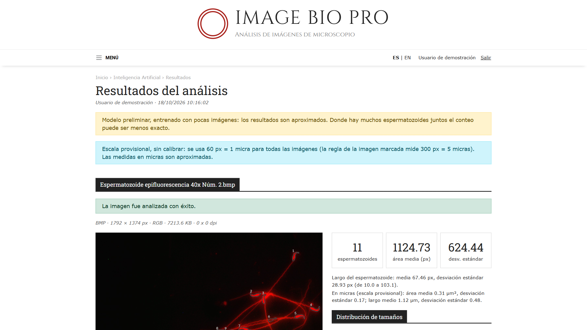

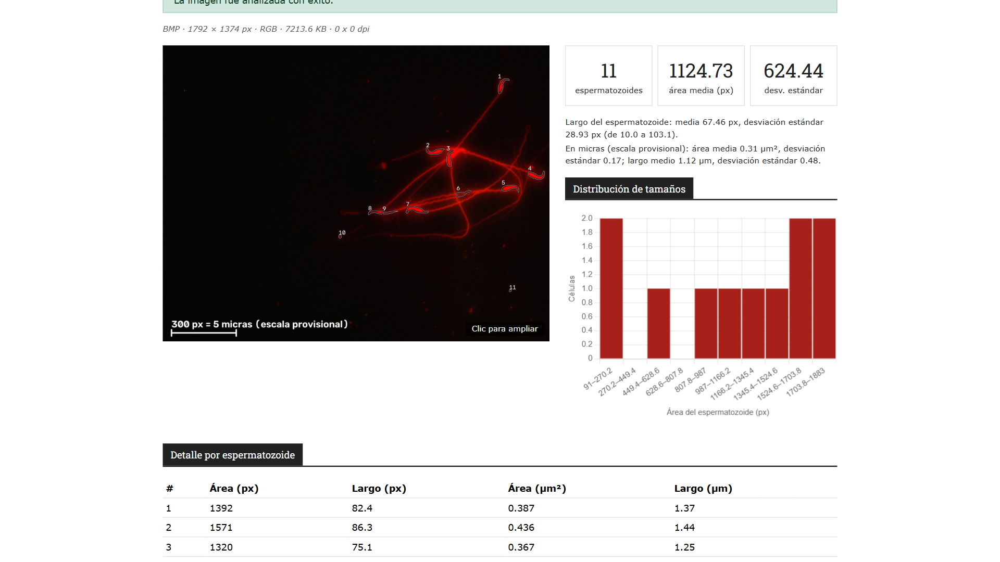

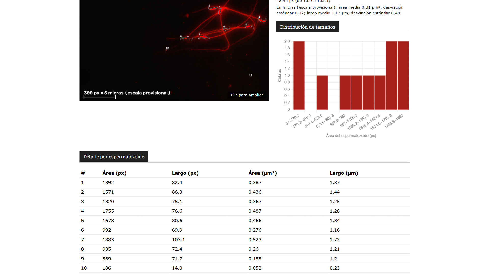

[Diapositiva 24 · La página de resultados, de arriba hacia abajo]

Esta es la página de resultados. La voy a leer con ustedes de arriba hacia abajo, porque cada elemento responde a una decisión o a un requisito, y verlos en conjunto es la mejor manera de saber qué se puede afirmar con estos datos y qué no.

El encabezado dice «Resultados del análisis» y, debajo, el nombre de quien hizo el análisis con la fecha y la hora exactas, hasta los segundos. Eso se pidió expresamente en las reuniones; se dijo que era muy importante. Tiene lógica: cuando se acumulan decenas de análisis, la fecha y la hora son lo que permite distinguirlos.

[Diapositiva 25 · Encabezado y recuadros de contexto]

Enseguida hay dos recuadros de contexto, y conviene leerlos porque son parte del resultado. El primero, en amarillo, señala el estado del modelo: está entrenado con un número acotado de imágenes y donde hay muchos espermatozoides juntos el conteo se lee como una estimación. El segundo, en azul, indica la escala que se usó: sesenta píxeles por micra para todas las imágenes. Los dos se repiten en el PDF. Fue una decisión consciente: quien reciba un informe sin haber visto esta pantalla sabrá con qué contexto leerlo.

Ahora el bloque de cada imagen. Con diez imágenes habría diez bloques, cada uno encabezado por el nombre del archivo. Empieza con los mensajes del análisis; aquí aparece uno verde, «La imagen fue analizada con éxito». Pero no es el único posible. El sistema puede avisar que la imagen está en un formato con compresión y que los bordes pueden alterarse; que se contaron muy pocos espermatozoides y la distribución de tamaños no es confiable; o, en el caso extremo, que no se encontraron espermatozoides o que la imagen es de mala calidad y no es factible analizarla. En ese último caso el sitio no entrega números dudosos, sino que dice claramente que no analizó la imagen. Fue una petición explícita: preferir un «no se pudo» honesto a un resultado engañoso que lleve a pensar que la red no sirve.

Debajo de los mensajes hay una línea pequeña con los metadatos de la imagen: formato, dimensiones en píxeles, modo de color, peso en kilobytes y, si el archivo lo trae, la resolución en puntos por pulgada. También va en el PDF, y se pidió porque permite saber con qué tipo de archivo se obtuvo cada resultado.

[Diapositiva 26 · Imagen marcada y datos principales]

A la izquierda está la fotografía analizada, con cada espermatozoide marcado y numerado; en un momento la ampliamos. A la derecha están los números.

Los tres recuadros grandes son los datos principales. El primero es el conteo: cuántos espermatozoides se detectaron. El segundo es el área media de los contornos, en píxeles. El tercero es la desviación estándar de esas áreas. Con la media y la desviación estándar se cumplió una petición de la segunda reunión, cuando el grupo preguntó si se podía imprimir la desviación estándar junto con la media.

Debajo, en letra más pequeña, hay dos líneas de texto. La primera describe el largo del espermatozoide: media y desviación estándar en píxeles, con el mínimo y el máximo observados. La segunda pasa el área y el largo a micras con la escala, y por eso lleva esa leyenda.

[Diapositiva 27 · «Distribución de tamaños»: un histograma]

Queda la gráfica, «Distribución de tamaños». Es un histograma: en el eje horizontal está el área del espermatozoide en píxeles, dividida en intervalos, y en el vertical cuántas células cayeron en cada intervalo. El mínimo y el máximo del eje se toman de cada imagen, como se acordó, de modo que la gráfica siempre aprovecha todo su ancho. El sitio no supone ninguna forma para esta distribución: puede salir como campana, con dos picos o de otra manera, lo que digan los datos. Solo dibujamos lo que se midió, sin compararlo con tamaños de referencia de ninguna especie, porque esa interpretación le corresponde al grupo.

Si hubiera subido varias imágenes, al final aparecería una segunda gráfica con los promedios. Para armarla, el sistema toma el mínimo y el máximo de todas las imágenes, divide ese rango en intervalos y calcula, para cada uno, el promedio de células entre las imágenes. Es la forma de resumir un lote entero en una sola figura.

### 2.5 Explorar la imagen: zoom, detalle y tabla

*477 palabras · 1.9 min*

[Acción: hacer clic sobre la imagen marcada. Se abre el visor en pantalla completa.]

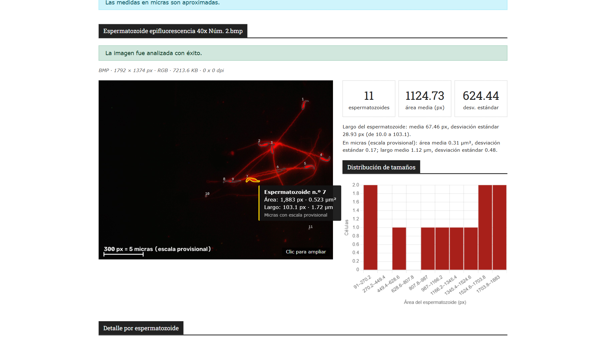

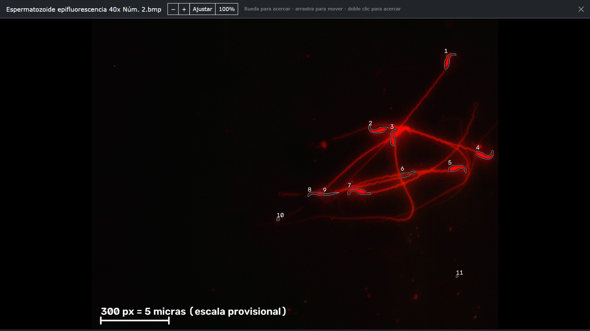

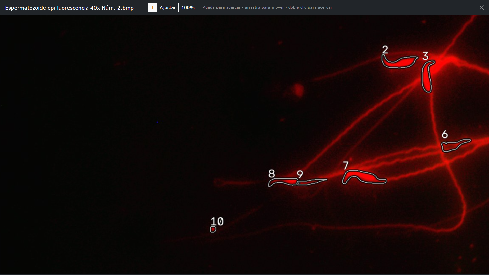

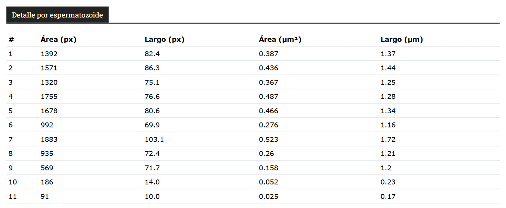

[Diapositiva 28 · Un visor con zoom para revisar cada contorno]

Hago clic sobre la fotografía y se abre un visor en pantalla completa con la imagen marcada. Arriba hay controles de zoom: el signo menos para alejar, el más para acercar, «Ajustar» para ver la imagen entera y «100 %» para verla a tamaño real, un píxel de la imagen por cada píxel de la pantalla. También se puede acercar y alejar con la rueda del ratón, moverse arrastrando, y acercar rápido con doble clic.

[Acción: acercar sobre una zona con varios espermatozoides, mover la imagen y volver a ajustar.]

Esto resuelve un problema práctico. Una fotografía de más de mil setecientos píxeles de ancho, con decenas o cientos de células, no se revisa a simple vista en una pantalla normal. Con el visor se puede acercar una zona dudosa y comprobar si el contorno que trazó el modelo corresponde de verdad a un espermatozoide, si dos células muy cercanas quedaron separadas o si una quedó partida en dos. Es la herramienta para aplicar lo que dije antes: la red propone y la persona verifica.

[Acción: pasar el ratón sobre un espermatozoide dentro del visor.]

[Diapositiva 29 · Al pasar el cursor, el detalle de cada espermatozoide]

Ahora, al colocar el cursor sobre un espermatozoide, aparece un recuadro pequeño con su número, su área y su largo, en píxeles y en micras. Funciona en el visor y también en la página de resultados. Por debajo, el sitio dibuja sobre la imagen una capa invisible con un polígono por espermatozoide, con exactamente los puntos del contorno que trazó el modelo, y detecta sobre cuál está el cursor. Los polígonos más grandes se ordenan primero para que los pequeños que quedan dentro de ellos sigan accesibles. Es un buen ejemplo de cómo el contorno que produce la red pasa, sin pasos intermedios, a ser información que el usuario consulta.

[Acción: cerrar el visor y bajar hasta la tabla.]

Cierro el visor y bajo. Después de las gráficas hay una tabla, «Detalle por espermatozoide», con una fila por contorno y cinco columnas: el número, que coincide con el de la imagen marcada, el área en píxeles, el largo en píxeles, el área en micras cuadradas y el largo en micras. Tiene su propia barra de desplazamiento para no alargar la página cuando hay muchos espermatozoides.

Esta tabla es la prueba de que todo se puede rastrear. Si el conteo dice ciento catorce, aquí están los ciento catorce contornos, cada uno con sus medidas y ubicable en la imagen por su número. Y es exactamente la misma información que tiene el CSV.

Una nota sobre la forma de medir, porque alguien con formación en análisis de imágenes lo preguntaría. El área es el número de píxeles encerrados por el contorno. El largo, como los espermatozoides son estructuras curvas, no se mide en línea recta entre dos puntos, sino a lo largo de la forma. Se acordó reportar área y largo mientras el grupo decide cuál usar como medida principal. Los dos se calculan con OpenCV a partir del contorno, sin intervención de la red, de modo que son reproducibles: el mismo contorno siempre da las mismas cifras.

### 2.6 Un ejemplo de lectura de resultados

*495 palabras · 2.0 min*

Los números de una pantalla solo sirven si sabemos leerlos, y la mejor forma de aprenderlo es con un ejemplo. Los valores que siguen son inventados para ilustrar; no corresponden a ninguna muestra.

[Diapositiva 30 · Dos fotografías del mismo tipo (valores inventados)]

Supongan que subimos dos fotografías del mismo tipo y el sitio devuelve esto. En la primera: ciento veinte espermatozoides, área media de novecientos píxeles y desviación estándar de ciento cincuenta. En la segunda: ochenta, área media de mil cien píxeles y desviación estándar de doscientos cincuenta.

¿Qué se puede decir? Veamos paso a paso.

El conteo. Ciento veinte contra ochenta no significa que la primera muestra tenga más espermatozoides en general, sino que esa fotografía tiene más. El conteo por imagen depende de qué zona se fotografió y de cuánta muestra había sobre la laminilla. Para comparar muestras por conteo hay que fijar antes un procedimiento de toma de fotografías.

La media y la desviación estándar. La segunda imagen tiene un área media mayor, y además una desviación estándar mayor. La desviación indica qué tan dispersos están los tamaños alrededor de la media. Con doscientos cincuenta sobre mil cien, la dispersión relativa es de un veintitrés por ciento aproximadamente, frente a un diecisiete por ciento en la primera. Hay más variación de tamaños en la segunda.

[Diapositiva 31 · ¿La diferencia es real o es ruido?]

Pero aquí debemos ser cuidadosos. La diferencia entre novecientos y mil cien, ¿es real o es ruido? Con ochenta y ciento veinte células y esas desviaciones, la media de cada imagen tiene un margen de error. Para afirmar algo hace falta una prueba estadística adecuada, y eso lo decide el grupo con sus propios criterios; el sitio entrega los datos por espermatozoide en el CSV precisamente para eso.

El histograma. Aunque dos imágenes tengan la misma media, pueden verse muy distintas. Una puede tener todos los tamaños agrupados alrededor de la media, y otra puede tener dos grupos, uno de tamaños chicos y otro de grandes, con una media que cae en medio donde casi no hay células. Por eso nunca hay que leer la media sin mirar la gráfica. El sitio no supone que la distribución sea una campana: dibuja lo que se midió.

[Diapositiva 32 · Leer los resultados como una medición]

Los píxeles y las micras. Si la misma comparación se hiciera en micras, con la escala de sesenta píxeles por micra, los números serían proporcionales y las conclusiones relativas no cambiarían, porque el mismo factor se aplica a todo. Las comparaciones entre imágenes del sitio son válidas con la misma escala.

Y la calidad del análisis. Antes de comparar nada, hay que mirar los avisos y la imagen marcada de cada fotografía. Si una de las dos tuvo mucha aglomeración, su conteo es el menos confiable. Eso se ve en el zoom en un minuto, y evita sacar conclusiones de un número que el propio sitio señala como estimación.

Con este ejemplo quiero mostrar un hábito: leer los resultados del sitio como se lee cualquier medición, preguntando qué tan precisa es, qué la puede alterar y con qué se puede comparar.

### 2.7 Avisos y casos que conviene conocer

*437 palabras · 1.7 min*

[Pantalla: volver a la página de análisis. Mostrar, uno por uno, los avisos de error más frecuentes si se desea. Si la demostración en vivo se complica, usar capturas preparadas.]

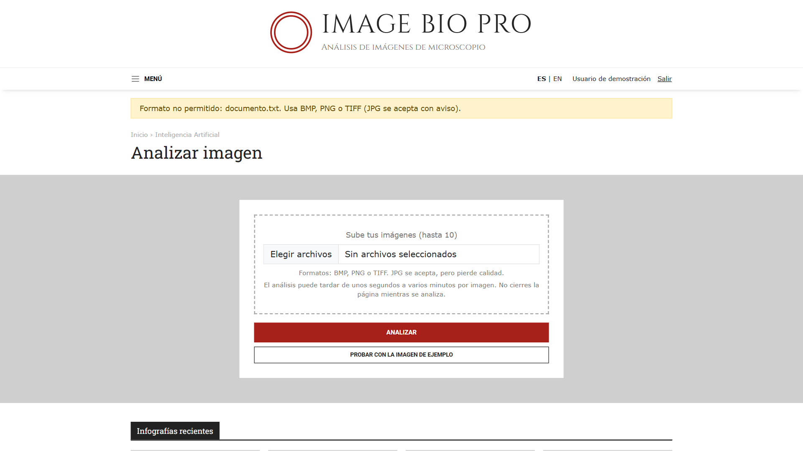

Hasta aquí vimos un análisis exitoso. Quienes usen el sitio también se van a topar con situaciones menos felices, y es mejor conocerlas ahora.

[Diapositiva 33 · Cuando el envío no es válido]

La primera es subir una cantidad de imágenes distinta de la permitida. Si no se elige ninguna y se hace clic en «Analizar», el sitio responde «Elige al menos una imagen». Si se eligen más de diez, dice que el máximo es diez por vez. El límite viene de las reuniones: se decidió desde el principio que fuera diez, y se aclaró que podía ser menos.

La segunda es subir un archivo con una extensión no admitida, por ejemplo un documento de texto o un PDF. El sitio rechaza el envío completo, nombra los archivos que no pasaron e indica que se usen BMP, PNG o TIFF, y que JPG se acepta con aviso. Revisa todo antes de analizar nada, de modo que un error en el décimo archivo no obliga a esperar el análisis de los nueve anteriores para enterarse.

[Diapositiva 34 · Cuando la imagen no se puede analizar]

La tercera es un archivo con extensión válida que no se puede abrir como imagen, por ejemplo porque está dañado. El resultado de esa imagen dice «No se pudo abrir el archivo como imagen. No se analizó», y las demás del lote se analizan con normalidad.

La cuarta es la que más pesa en la confianza: una imagen que se abre bien pero en la que el modelo no encuentra nada. Puede estar desenfocada, ser de mala calidad o no ser de espermatozoides. El sitio responde que no se encontraron espermatozoides o que la imagen es de mala calidad, y que no es factible analizarla.

La quinta es contar muy pocos espermatozoides. Con menos de tres, el sitio entrega el conteo y las medidas, pero añade un aviso: la distribución de tamaños no es confiable. Tiene sentido estadístico, porque un histograma hecho con una o dos observaciones no representa nada.

[Diapositiva 35 · Si faltan los modelos, el sitio no se cae]

La sexta es que los modelos no estén disponibles. Si en el servidor faltaran sus archivos, o la biblioteca que los ejecuta, el sitio no se cae: usa una detección más simple, basada en un umbral de color, y lo anuncia con un recuadro amarillo. Es una red de seguridad pensada para el desarrollo y para fallos de despliegue. En la operación normal no debería verse nunca, pero si alguien la ve, sabrá qué significa.

En todos estos casos el sistema le dice al usuario qué pasó. Es una decisión de diseño que viene de una frase de la reunión: que la persona diga «ah, no la analizó», en lugar de recibir un resultado dudoso y concluir que la red no sirve.

### 2.8 Un lote de varias imágenes y los dos modelos

*415 palabras · 1.7 min*

[Pantalla: volver a «Analizar imagen». Subir un lote preparado de tres imágenes: dos de fluorescencia y una de fondo claro. Mientras corre el análisis, continuar con el texto.]

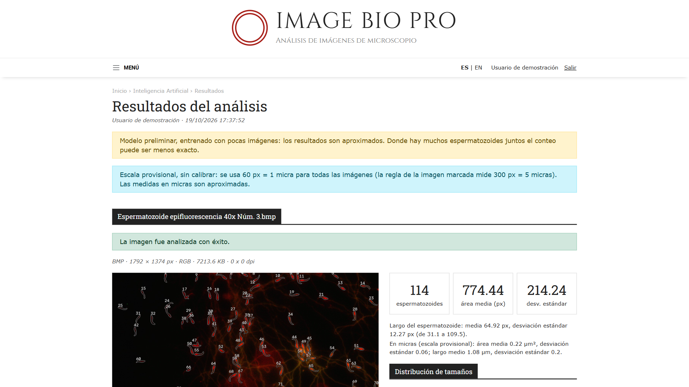

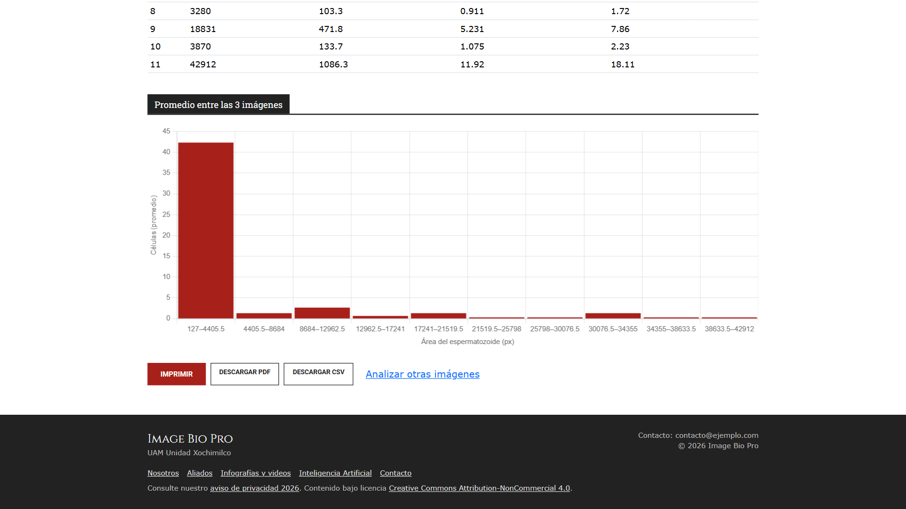

[Diapositiva 36 · Tres fotografías, dos tipos de fondo]

Hasta ahora vimos una sola imagen. Para mostrar el sistema como lo usaría el grupo en el trabajo diario, subo un lote de tres fotografías: dos de fluorescencia, con fondo oscuro, y una de fondo claro. Las elegí para que veamos cómo decide el sitio qué modelo aplicar a cada una.

Selecciono los tres archivos en el campo de carga, que acepta varios a la vez, y hago clic en «Analizar». Mientras corre, explico esa decisión, que es un buen ejemplo de una regla simple que resuelve un problema real.

[Diapositiva 37 · Una regla simple elige el modelo]

Hay dos modelos porque los dos tipos de fotografía se ven muy distintos. En una, los espermatozoides son brillantes sobre fondo negro; en la otra, oscuros sobre fondo claro. Un solo modelo para ambas habría pedido muchas más imágenes. Con las que tenemos funcionó mejor entrenar uno por tipo. Y el sitio sabe cuál usar midiendo el brillo: toma el valor máximo de los tres canales de color en cada píxel, calcula la mediana de todos esos valores y, si pasa de ciento veintisiete en una escala de cero a doscientos cincuenta y cinco, considera la foto de fondo claro. Si no, de fondo oscuro. No hay aprendizaje en esa decisión. Es comparar un número con un umbral, lo cual la hace fácil de entender, de verificar y de ajustar.

Cada imagen del lote se analiza de forma independiente. El modelo que se aplica a la primera no condiciona el de la segunda, y si una no se puede analizar, las otras siguen. El sitio también guarda con qué detector se analizó cada imagen, para saber después, al revisar un análisis viejo, qué se usó.

[Acción: cuando termine el análisis, mostrar los tres bloques de resultados y la gráfica de promedios al final.]

[Diapositiva 38 · Un bloque por imagen y un promedio del lote]

Ya está. La página tiene ahora tres bloques, uno por imagen, cada uno con su fotografía marcada, sus datos y su gráfica. Y al final, como no hay una sola imagen, aparece una cuarta gráfica titulada «Promedio entre las tres imágenes». Es el resumen del lote que describí: el rango sale de las tres imágenes, se divide en intervalos y, para cada uno, se promedia el número de células. Si el grupo analiza las diez fotografías de una misma muestra, esa gráfica da una sola vista del conjunto.

Una aclaración sobre esa gráfica. Promediar fotografías de fondo claro con otras de fluorescencia no es buena idea, porque se tomaron y se entrenaron de manera distinta. Lo hago aquí solo para la demostración. En el uso real lo razonable es promediar imágenes comparables: mismo tipo de fotografía, misma muestra o condición.

### 2.9 La escala en micras

*331 palabras · 1.3 min*

[Pantalla: la imagen marcada de una de las fotografías, con la regla en la esquina inferior izquierda. Acercar con el visor hasta que se lea el texto de la regla.]

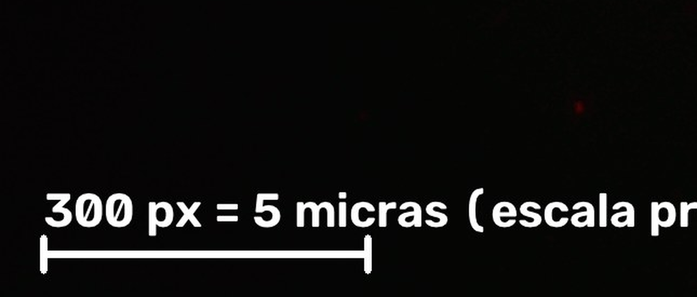

Dedico unos minutos a la escala, porque es el punto que pide más precisión y el que más dudas genera.

[Diapositiva 39 · La regla de la imagen marcada]

En la esquina inferior izquierda de la imagen marcada hay una regla: una línea de trescientos píxeles con el texto «300 px = 5 micras». Se añadió para que cualquiera que mire la imagen vea de inmediato qué equivalencia se está usando.

Para entender cómo se llega a una escala hay que partir de algo simple: una fotografía digital sabe cuántos píxeles mide, pero no cuántas micras corresponden a cada uno. Esa relación depende del aumento del objetivo, que en nuestro caso es de cuarenta aumentos, del tamaño del sensor de la cámara, de cualquier adaptador intermedio y de la resolución a la que se guardó la foto. Y las imágenes que el grupo ha compartido no traen barra de escala impresa, ni la cabecera de los archivos guarda esa información.

Se podría intentar deducir la escala suponiendo el tamaño de alguna estructura de la imagen. Decidí no hacerlo. Calibrar una medición con el tamaño supuesto de lo mismo que luego se va a medir es un razonamiento circular: el resultado confirmaría la suposición del principio. Cualquier valor de escala tiene que venir de una medida independiente.

[Diapositiva 40 · Sesenta píxeles por micra]

El sitio usa sesenta píxeles por micra: una raya de trescientos píxeles equivale a cinco micras. Por eso cada resultado indica la escala que se usó: en pantalla, en el CSV y en el PDF.

La escala se guarda en una tabla de escalas, con un valor de píxeles por micra para cada resolución en que se guardan las fotos. Las del grupo vienen en dos tamaños, de unos mil setecientos noventa y dos y tres mil quinientos ochenta y cuatro píxeles de ancho, y cada resolución tiene su propio valor. La tabla es un archivo de configuración que se edita sin tocar el código.

Los píxeles son lo que realmente se midió; las micras son esa medida por el factor de la escala.

### 2.10 Descargar el CSV y el PDF

*559 palabras · 2.2 min*

[Pantalla: bajar al final de la página de resultados, donde están los botones.]

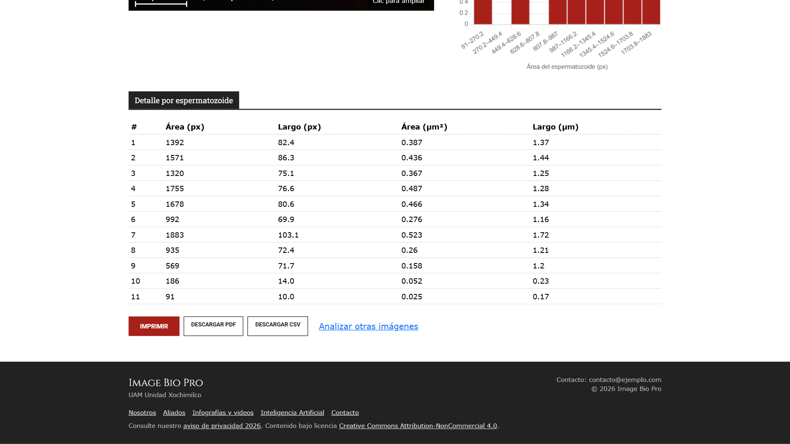

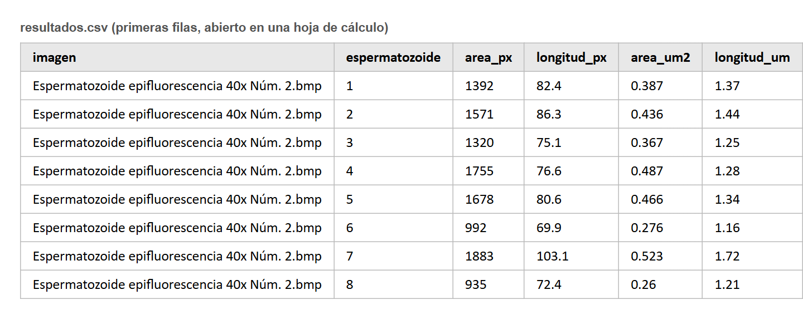

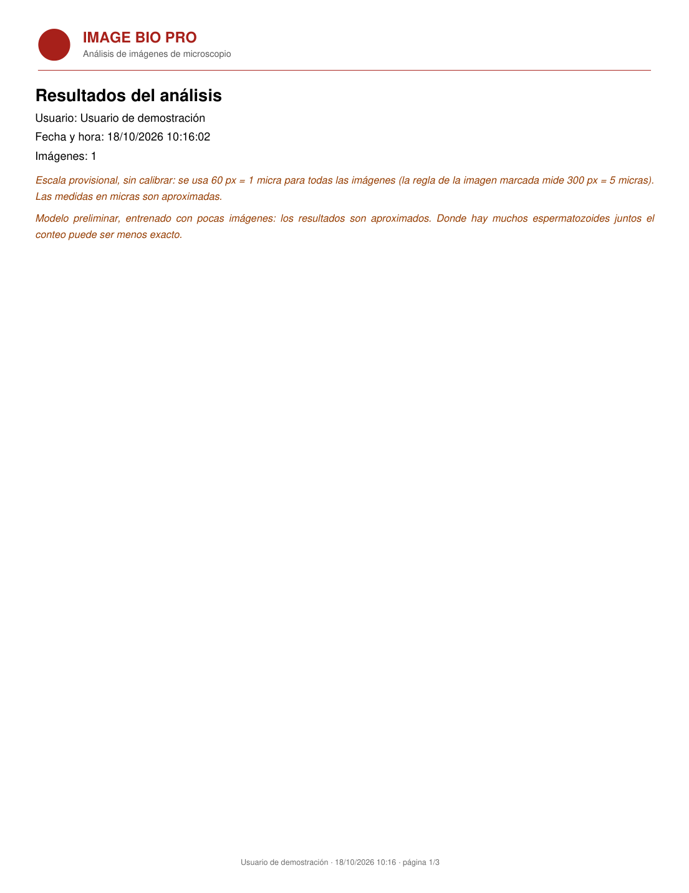

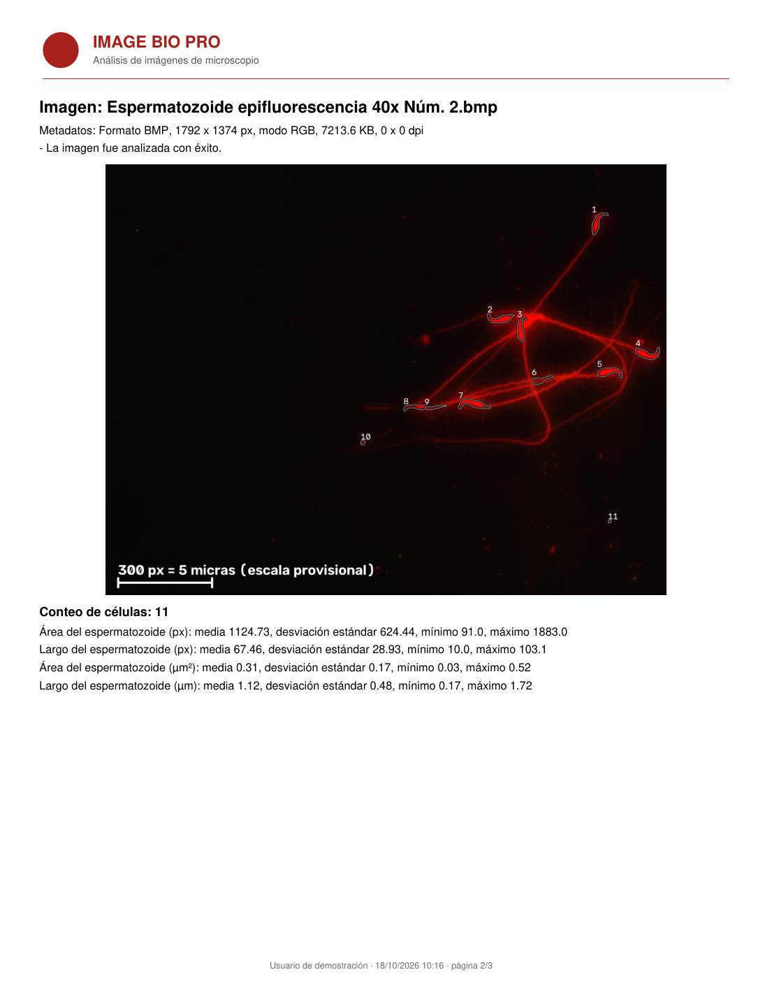

Al final de la página están los botones de salida. Como se pidió, la opción de imprimir va hasta abajo, después de todo el contenido, junto a los botones para descargar el PDF y el CSV y un enlace para analizar otras imágenes.

[Acción: hacer clic en «Descargar CSV» y abrir el archivo en una hoja de cálculo.]

[Diapositiva 41 · El CSV: una fila por espermatozoide]

Empiezo por el CSV: un archivo de texto con valores separados por comas, que cualquier hoja de cálculo abre sin problema y que cualquier lenguaje de programación lee con una línea. Tiene seis columnas: nombre de la imagen, número del espermatozoide, área en píxeles, largo en píxeles, área en micras cuadradas y largo en micras. Cada fila es un espermatozoide. Si el análisis incluyó varias imágenes, todas están en el mismo archivo, identificadas por la primera columna, así que filtrar o agrupar es sencillo.

Para quien trabaja con datos, este es el formato más útil, porque permite seguir más allá del sitio: calcular otras estadísticas, hacer pruebas, cruzar con otras variables, graficar con las herramientas propias. Y como el sitio entrega los datos por espermatozoide y no solo los resúmenes, el grupo no depende de las cifras que el sitio decida mostrar.

[Acción: hacer clic en «Descargar PDF» y abrir el archivo.]

[Diapositiva 42 · El PDF: un informe con un análisis por imagen]

Ahora el PDF, que es un informe. La primera página reúne lo que se pidió: el encabezado con el nombre del proyecto y el lema, el nombre del usuario, la fecha y la hora del análisis y el número de imágenes. El encabezado de cada página lleva el círculo y el nombre del proyecto, y ahí va el logotipo; en el pie aparecen el usuario, la fecha y el número de página. Después vienen los dos recuadros de contexto que ya conocemos, escala y estado del modelo, para que el informe se lea con el contexto correcto aunque circule sin la pantalla.

Luego hay una página por imagen, con el nombre del archivo, los metadatos, los mensajes del análisis, la imagen marcada con sus contornos y su regla de escala, el conteo, la media y la desviación estándar del área y del largo, y la gráfica de distribución. Con varias imágenes se añade al final una página con la gráfica de promedios. Todo va en un solo PDF, como se pidió: diez imágenes no producen diez archivos sino un documento con diez análisis.

[Diapositiva 43 · Las gráficas de pantalla y las del PDF]

Un detalle técnico para los programadores del grupo. Las gráficas de la pantalla y las del PDF no se generan con la misma herramienta. En pantalla se dibujan en el navegador con Chart.js, lo que las hace interactivas y ligeras. En el PDF se dibujan en el servidor con matplotlib y se incrustan como imagen, porque un PDF necesita contenido ya resuelto. Los datos son los mismos; cambia el motor de dibujo. El PDF mismo se arma con la biblioteca fpdf2.

[Acción: volver a la página de resultados y hacer clic en «Imprimir».]

Por último, «Imprimir». Abre el cuadro de impresión del navegador, y la hoja de estilo oculta lo que no tiene sentido en papel: el menú, los botones y la ruta de navegación. Se imprime solo el contenido del análisis. Es la forma más rápida de obtener una copia en papel, o un PDF de la pantalla, si no hace falta el informe formal.

[Diapositiva 44 · Imprimir, y un PDF que se genera una sola vez]

El PDF se genera una sola vez, en el momento del análisis, y se guarda en el servidor. Cuando se vuelve a descargar no se recalcula: se entrega el mismo archivo. Así, el informe que descargan hoy y el que descarguen dentro de un mes son idénticos.

### 2.11 Mis análisis, privacidad y borrado de las imágenes

*393 palabras · 1.6 min*

[Pantalla: hacer clic en el nombre del usuario, en la barra superior, para abrir el perfil.]

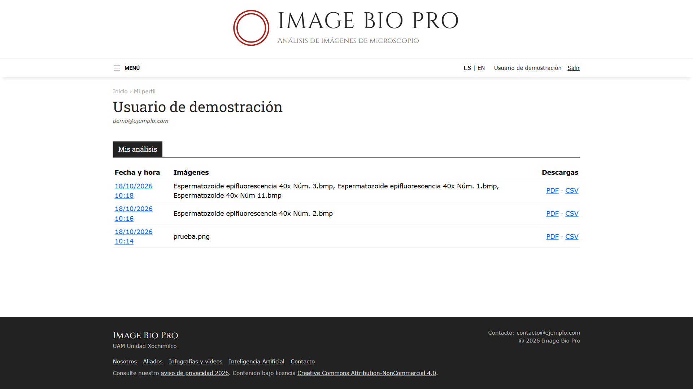

Hago clic en mi nombre, arriba, y llego al perfil. Aparecen mi nombre y mi correo, y debajo una sección llamada «Mis análisis».

[Diapositiva 45 · El perfil y la sección «Mis análisis»]

Es una tabla con una fila por análisis. Cada fila muestra la fecha y la hora, los nombres de las imágenes analizadas y los enlaces para descargar el PDF y el CSV. La fecha es un enlace: al hacer clic se abre la página de resultados de ese análisis, tal como se vio al hacerlo, con la imagen marcada, los números, las gráficas y la tabla. Es una vista de consulta. Nada se recalcula, y las cifras son las que se guardaron en ese momento.

[Acción: abrir el primer análisis de la lista.]

Aquí está el análisis que hicimos hace unos minutos, y se ve igual que cuando terminó. Es posible porque, al terminar cada análisis, el sitio guarda en la base de datos los resultados completos, incluidos los contornos de cada espermatozoide, y guarda en disco una copia reducida de la imagen marcada y el PDF. Lo que no guarda es la imagen original.

Las imágenes que se suben se borran del servidor en cuanto termina su análisis. Fue un requisito explícito de las reuniones, y en el código se cumple sin depender de que todo salga bien: el borrado está en un bloque que se ejecuta siempre, incluso si el análisis falló a medias. Queda la copia reducida con las marcas y la regla de escala, para poder volver a ver el análisis, y el PDF. Una consecuencia práctica: si el grupo quiere volver a analizar una imagen con un modelo nuevo, tendrá que subirla otra vez, porque el sitio no la conserva. Conviene que el grupo guarde sus originales en su propio sistema.

[Diapositiva 46 · Cada análisis pertenece a quien lo hizo]

Sobre privacidad: cada análisis pertenece a quien lo hizo y solo esa persona puede verlo. Si otro usuario intentara abrir la dirección de un análisis ajeno, el sitio respondería como si esa página no existiera. Lo mismo vale para las imágenes marcadas y los archivos descargables. Esto lo planteó el desarrollador en las reuniones y el grupo lo aceptó.

Y quién puede ver el código de la red: nadie desde el sitio. Los archivos de los modelos viven en el servidor y no hay ninguna página que los exponga, como se pidió.

Para cerrar el recorrido, salgo con el botón «Salir». El sitio avisa y me devuelve a la página de inicio.

### 2.12 Preguntas frecuentes sobre el uso del sitio

*372 palabras · 1.5 min*

Con la experiencia de las pruebas, junté las dudas que más probablemente van a surgir al usar el sitio.

[Diapositiva 47 · Cuenta, límites y resultados]

¿Qué pasa si olvido mi contraseña? Se puede crear una cuenta con otro correo, o avisarme para resolverlo.

¿Puedo subir más de diez imágenes? No en un solo envío. El límite sale de las reuniones. Si hay más, se hacen varios envíos, y cada uno genera su PDF.

¿Por qué el mismo archivo da el mismo resultado cada vez? Porque el modelo no cambia entre análisis y los cálculos de medición son deterministas. Si el resultado cambiara de un día a otro sin que se haya cambiado el modelo, sería señal de un problema, y me lo deben reportar.

¿Puedo recuperar la imagen original que subí? No: el sitio la borra al terminar el análisis. Lo que se conserva es el PDF, la copia reducida con las marcas y los datos. Hay que guardar los originales por cuenta propia.

¿Otros usuarios pueden ver mis análisis? No. Cada análisis es visible solo para quien lo hizo.

¿Hay un límite de peso por envío? Sí. El servidor acepta hasta trescientos megabytes por envío, que es lo que ocupan unas diez imágenes en BMP, el formato más pesado. Los PNG y TIFF comprimidos sin pérdida ocupan bastante menos. Si un envío supera el límite, el servidor lo rechaza antes de que el sitio llegue a analizar nada, y la solución es dividirlo en dos envíos.

[Diapositiva 48 · Otras muestras, avisos y dónde se analiza]

¿Se puede analizar una foto de otra tinción o de otro tipo de célula? Se puede subir, pero el resultado no es confiable. Los modelos actuales aprendieron de las fotografías del grupo. Para otras condiciones hay que reentrenar.

¿Qué hago si el sitio dice que no pudo analizar una imagen? Revisar el formato, que sea BMP, PNG o TIFF, y que la imagen sea de buena calidad y esté enfocada. Si el archivo es bueno y el aviso persiste, conservar la imagen y avisarme; puede ser un caso que valga la pena agregar al entrenamiento.

¿El análisis se hace en mi computadora? No. Se hace en el servidor, y el navegador solo envía la imagen y muestra el resultado. Por eso no hace falta instalar nada ni tener una computadora potente.

### 2.13 Recomendaciones para usar el sitio en el trabajo diario

*385 palabras · 1.5 min*

Antes de cerrar la demostración les dejo una guía breve de uso, que sale de lo que vimos. No son reglas del sistema sino recomendaciones para que los resultados sirvan más.

[Diapositiva 49 · Cinco hábitos para usar el sitio]

Trabajar siempre con los archivos originales. Si la cámara o el programa del microscopio permiten guardar en BMP o TIFF, esa es la mejor opción. Hay que evitar el JPG y, sobre todo, que las fotos pasen por aplicaciones de mensajería antes de llegar al sitio. La compresión modifica los bordes, y los bordes son lo que la red necesita para trazar contornos y lo que la medición necesita para calcular áreas y largos.

Agrupar las imágenes por tipo y condición. El sitio deja subir hasta diez a la vez y la gráfica de promedios resume el lote. Para que ese resumen tenga sentido, las imágenes de un mismo envío deben ser comparables: mismo tipo de fotografía, misma resolución, misma muestra o la misma condición experimental. Para comparar condiciones distintas, conviene hacer un envío por condición y comparar después los CSV.

Revisar la imagen marcada antes de confiar en los números. El visor con zoom está pensado para eso. Dos minutos de revisión permiten detectar contornos partidos, células sin marcar o marcas sobre algo que no es un espermatozoide. Y anotar, para cada imagen, si la revisión visual coincide con el conteo, porque esa información será muy valiosa cuando se reentrene el modelo.

Guardar el CSV. Es el registro completo del análisis, con una fila por espermatozoide, y permite repetir las estadísticas o combinarlas con otros datos. El PDF es el informe para leer y compartir; el CSV es el dato para trabajar. Conviene conservar los dos, con el nombre de la muestra en el nombre del archivo.

Llevar un registro de las imágenes que el modelo analiza con dificultad. Si una fotografía da un resultado claramente distinto de lo que se ve, por ejemplo muchos contornos partidos o un número de células muy diferente del que se cuenta a simple vista, vale la pena conservarla y anotar qué pasó. Esas imágenes son las que más aportan al reentrenamiento, porque muestran justo lo que el modelo puede aprender a resolver. Un modelo mejora con ejemplos de sus propios retos, y el grupo es quien los tiene.

Con esto queda cubierto el uso del sitio.

### 2.14 Cierre del tema y puente a la siguiente parte

*152 palabras · 0.6 min*

Resumo lo recorrido.

El sitio tiene una parte informativa, bilingüe y sencilla, y una parte de análisis a la que se accede con una cuenta gratuita. El usuario sube hasta diez imágenes, el sistema elige el modelo según el brillo de cada una y devuelve el conteo, el área y el largo de cada espermatozoide con su media y desviación estándar, la distribución de tamaños y una imagen con cada contorno marcado. El resultado se explora con zoom y con detalle por espermatozoide, y se exporta a CSV y PDF. Cada análisis queda en el perfil del usuario, es privado, y las imágenes originales se borran. Y cada resultado indica con claridad la escala que se usó y el estado del modelo.

[Diapositiva 50 · ¿Cómo sabe el sistema dónde hay un espermatozoide?]

Seguramente muchos tienen ahora una pregunta: ¿cómo sabe el sistema dónde hay un espermatozoide? La respuesta es la red neuronal, y a ella dedicamos la última parte de la sesión.

## Tema 3. ¿Qué es una red neuronal?

*11,663 palabras · 46.7 min a 250 palabras por minuto*

### 3.1 Planteamiento del problema

*803 palabras · 3.2 min*

[Diapositiva 51 · ¿Qué es una red neuronal?]

Entramos a la última parte, y una advertencia sobre cómo voy a explicar. Este tema es de los más técnicos del proyecto y se pone abstracto con facilidad. Para evitarlo voy de lo concreto a lo general: un problema que podamos imaginar, luego la idea que lo resuelve y al final el nombre técnico. No uso ecuaciones. Cuando una idea tenga expresión matemática, diré con palabras qué hace. La meta de estos cincuenta minutos es que quede claro cómo responder tres preguntas: qué es una red neuronal, cómo aprende, y por qué una red entrenada para otra cosa nos sirve para contar espermatozoides.

Partamos del problema. Supongan que tienen que escribir un programa que reciba una fotografía y diga cuántos espermatozoides hay. Es la tarea del sitio. ¿Cómo lo harían con programación tradicional, escribiendo reglas explícitas?

[Diapositiva 52 · Umbralización]

La primera idea natural es usar el brillo. Los espermatozoides son brillantes sobre fondo oscuro, así que se podría decir: todo píxel con un brillo mayor a cierto valor pertenece a una célula. Luego se agrupan los píxeles vecinos en manchas, y cada mancha es una célula. Esa técnica se llama umbralización, y el sitio la incluye como respaldo: es la detección de emergencia que mencioné. Como primera aproximación sirve, pero los problemas aparecen pronto. Las colas también brillan, y no queremos contarlas. Hay manchas rojas difusas, más grandes y fuera de foco, que pasan el umbral sin ser espermatozoides. Hay células encimadas entre sí o sobre las colas de otras, y el umbral las une en una sola mancha. Además, el brillo de una imagen depende de la iluminación, de la exposición y de la tinción: un umbral que funciona en una fotografía puede fallar en la siguiente.

Se pueden seguir agregando reglas. Si la mancha es muy alargada, probablemente es una cola. Si es muy grande, probablemente es una mancha difusa. Si tiene forma de ocho, probablemente son dos células juntas y hay que partirla por el estrechamiento. Cada regla ayuda un poco y trae sus excepciones. La lista crece, se enreda, y cada excepción nueva obliga a modificar el programa con el riesgo de romper lo que ya funcionaba. Hay problemas en los que escribir las reglas a mano es muy difícil, no por falta de ingenio sino porque las reglas verdaderas son demasiadas, demasiado sutiles y dependen de demasiados detalles.

Piensen ahora en cómo lo hace una persona. Quien tiene experiencia mira la fotografía y señala los espermatozoides. ¿Aplica una lista de reglas? Casi seguro que no de manera consciente. Ha visto cientos o miles de ejemplos y su cerebro aprendió a reconocer el patrón. Si le preguntan por qué esto sí es una célula y esto no, quizá dé un par de razones, pero no podría enumerar todo lo que está usando.

[Diapositiva 53 · Una inversión del flujo]

De ahí sale el aprendizaje automático, que cabe en una frase: en lugar de escribir las reglas, se muestran ejemplos y se deja que el sistema las encuentre. En la programación tradicional se entregan reglas y datos, y salen respuestas. En el aprendizaje automático se entregan datos y respuestas, y salen las reglas. Es una inversión del flujo, y de ella depende todo lo que sigue.

Muchas familias de técnicas siguen esa idea, desde modelos estadísticos sencillos hasta arquitecturas muy complejas. Las redes neuronales son una de ellas, y rinden especialmente bien con imágenes, sonido o texto, es decir, datos crudos con mucha estructura que no se describen fácilmente con unas pocas variables. Por eso usamos una.

Una distinción de términos, porque se mezclan seguido. La inteligencia artificial es el campo más amplio: cualquier técnica que haga que una máquina realice tareas que asociamos con la inteligencia. El aprendizaje automático es la parte que aprende de ejemplos. Las redes neuronales son una técnica dentro de ella. Y el aprendizaje profundo se refiere a redes con muchas capas, que explico en un momento. Aquí usamos una red de aprendizaje profundo, la técnica que mejor funciona hoy con imágenes.

[Diapositiva 54 · Una red neuronal no entiende qué es un espermatozoide]

Hay otra idea previa que condiciona cómo van a escuchar el resto. Una red neuronal no entiende qué es un espermatozoide. No tiene el concepto ni sabe de biología; no sabe qué es una célula ni para qué sirve contarla. Tiene una enorme colección de números ajustados de modo que, ante ciertos patrones de píxeles, produce una salida que coincide con lo que las personas marcaron en los ejemplos. Es un reconocedor de patrones muy sofisticado, y nada más. Eso no le quita mérito; sirve para razonar sobre cuándo va a funcionar y cuándo no. Si le muestro una imagen parecida a las de su entrenamiento, funciona. Si le muestro algo muy distinto, no tiene cómo saber que se equivoca, y producirá una salida con la misma seguridad aparente.

Con el problema planteado, construyamos la idea de red desde su pieza más pequeña.

### 3.2 La neurona artificial

*901 palabras · 3.6 min*

[Diapositiva 55 · Multiplicar, sumar y activar]

La pieza elemental se llama neurona artificial, aunque el nombre es más una inspiración histórica que una descripción fiel de la biología. Es una operación muy pequeña, que se describe en cuatro pasos.

Primero, recibe una lista de números, las entradas. Segundo, cada entrada se multiplica por otro número, su peso. Tercero, se suman los resultados. Y cuarto, a esa suma se le aplica una pequeña función que decide cuánto se activa la neurona. Eso es todo.

[Diapositiva 56 · Qué le importa a la neurona]

Un ejemplo deliberadamente simple para ver qué hace un peso. Imaginen una neurona que decide si un punto de la imagen es rojo e intenso. Recibe tres entradas: la cantidad de rojo, de verde y de azul de un píxel. Para que dé una salida alta con un píxel muy rojo, le asignamos un peso grande y positivo a la entrada del rojo, y pesos pequeños o negativos a las otras dos. Un píxel muy rojo produce una suma grande, y uno azul una suma pequeña. Los pesos expresan qué le importa a la neurona. Un peso grande dice «esto me importa mucho», uno cercano a cero dice «me da igual», y uno negativo dice «esto me hace dudar».

Falta un elemento, un número que se suma al final, llamado sesgo. Desplaza el punto desde el cual la neurona empieza a activarse. Si la imaginan como un interruptor sensible, los pesos deciden a qué se fija y el sesgo decide qué tan exigente es antes de encenderse.

[Diapositiva 57 · Se apaga sin estímulo y responde con él]

La función de activación, el último paso, es lo que hace posible que las redes sean tan potentes. Si la neurona solo multiplicara y sumara, haría una operación lineal, y encadenar muchas operaciones lineales equivale a una sola: no importa cuántas capas se apilen, el resultado sería tan limitado como el de una. La función de activación introduce una no linealidad. La más usada hoy es simple: si la suma es negativa, la salida es cero; si es positiva, la salida es la propia suma. La neurona se apaga si no recibe estímulo suficiente y responde de forma proporcional si lo recibe. Esa pequeña torcedura permite representar relaciones complicadas, no solo proporcionales.

Una neurona sola hace muy poco: una decisión simple basada en una combinación ponderada. La potencia aparece al juntar muchas.

La siguiente escala es la capa: un conjunto de neuronas que reciben las mismas entradas pero con pesos distintos, de modo que cada una se fija en una combinación diferente. Cien neuronas mirando los mismos números, cada una con su criterio. La salida de la capa es la lista de las cien respuestas. Cada neurona es una pregunta distinta a la entrada, y la capa devuelve la lista de respuestas.

[Diapositiva 58 · Cada capa resume a la anterior]

Luego se apilan capas. La salida de una se convierte en la entrada de la siguiente. La primera hace cien preguntas sobre los datos originales. La segunda no ve los datos originales sino las respuestas de la primera, y hace sus propias preguntas sobre ellas. La tercera pregunta sobre las respuestas de la segunda, y así. Cada capa trabaja con un resumen más abstracto de la anterior. Esta arquitectura es la red neuronal, y cuando tiene muchas capas se habla de aprendizaje profundo: profundo, literalmente, por las capas apiladas.

Visualicen la estructura. Hay una entrada, los números que describen el dato. Hay una cascada de capas intermedias que los transforman una y otra vez. Y hay una salida, la respuesta final. En un clasificador sencillo podría ser un número entre cero y uno que indique qué tan probable es que la imagen contenga un espermatozoide. En un modelo más elaborado, como el nuestro, la salida es más rica, pero el principio es el mismo.

[Diapositiva 59 · Muchísimos]

Natural preguntar cuántos pesos tiene una red como la nuestra: muchísimos. La Mask R-CNN que usamos tiene decenas de millones. Por eso el archivo de cada modelo pesa unos ciento setenta y seis megabytes: en su mayor parte es la lista de pesos. Que un modelo esté «entrenado» significa que cada uno de esos millones de números ya tiene un valor adecuado. Un modelo sin entrenar tiene los mismos pesos con valores arbitrarios y produce respuestas sin sentido. El entrenamiento es el proceso que encuentra los valores correctos.

A quienes vienen de la programación tradicional esto suele sorprenderles: nadie asigna esos pesos a mano. Ni yo ni el grupo decidimos que la neurona número cuatro mil doscientos vale 0.37. Los valores salen del aprendizaje. Lo que yo decido es la arquitectura, es decir, cuántas capas hay y cómo se conectan, y los datos con que se entrena. Eso es lo que en los hechos construye el modelo.

[Diapositiva 60 · Con cautela]

La analogía con el cerebro conviene tomarla con cautela. El concepto nació de la idea de que las neuronas biológicas reciben señales, las ponderan y se activan según el total. Pero una neurona artificial es mucho más simple que una biológica, y la red completa no funciona como un cerebro. Lo útil de la analogía son las muchas unidades simples que, en capas, producen comportamientos complejos. Pensar que, por llamarse neuronal, la red «piensa» o «comprende» sería un error.

Resumo con un esquema que usaremos hasta el final. Una red neuronal es una cadena de capas. Cada capa toma números, los combina con pesos, aplica una pequeña no linealidad y pasa el resultado a la siguiente. Los pesos son lo que la red sabe. Falta ver cómo conseguir que esos pesos tomen valores útiles.

### 3.3 Cómo aprende una red

*995 palabras · 4.0 min*

[Diapositiva 61 · Predecir, comparar, ajustar, repetir]

¿Cómo se logra que millones de pesos tomen valores útiles? Con un proceso de ensayo y corrección bastante parecido a cómo aprendemos las personas. Lo describo en cuatro pasos y luego los desarrollo.

Primero, la red hace una predicción con los pesos que tiene en ese momento. Segundo, se compara con la respuesta correcta, que alguien proporcionó, y se mide cuánto se equivocó. Tercero, se ajustan un poco los pesos en la dirección que habría reducido el error. Cuarto, se repite con otro ejemplo, y otro, miles de veces.

[Diapositiva 62 · Antes de entrenar, los pesos son arbitrarios]

El punto de partida: antes de entrenar, los pesos tienen valores arbitrarios. Si le damos una imagen, la red responde, pero la respuesta es casi aleatoria. Con una imagen de ciento cuarenta espermatozoides podría marcar regiones al azar.

Para mejorar, la red necesita saber cuánto se equivocó. Esa medida se llama función de pérdida: un número que resume la distancia entre lo que la red predijo y lo que debió predecir. Si marca justo los espermatozoides que las personas marcaron, la pérdida es pequeña; si marca otras cosas o se le escapan muchos, es grande. La pérdida solo tiene que cumplir dos condiciones: ser más baja mientras mejor sea la predicción, y poder calcularse de forma automática. Todo el aprendizaje consiste en lograr que baje.

[Diapositiva 63 · Las dan personas, no la red]

Sobre el origen de las respuestas correctas, algo que tiene consecuencias prácticas para el grupo. No las da la red ni el desarrollador: las dan personas. Alguien tuvo que mirar cada fotografía de entrenamiento y marcar, con un contorno, cada espermatozoide. A ese trabajo se le llama anotación o etiquetado, y es la fuente de lo que el modelo aprende. En nuestro caso se hizo con una herramienta llamada CVAT. Lo importante es que el modelo solo puede aprender a reproducir lo que las personas marcaron. Si las marcas tienen errores, aprende los errores. Si siguen un criterio, aprende ese criterio. Un modelo es, en cierto sentido, un espejo comprimido de sus anotaciones.

Tercer paso, ajustar, que es la parte más ingeniosa. Imaginen que están en una montaña con niebla densa y quieren llegar al valle más bajo. No ven el paisaje, pero sienten la inclinación del suelo bajo los pies. En cada paso avanzan un poco hacia donde el suelo baja más. No saben dónde está el valle, pero siguiendo la pendiente descendente llegan, poco a poco, a un lugar bajo.

[Diapositiva 64 · La imagen de la montaña, casi literal]

Esa imagen es casi literalmente el algoritmo con que se entrena una red: el descenso del gradiente. La altura del terreno es la pérdida. La posición es el conjunto de todos los pesos. La inclinación del suelo, el gradiente, indica para cada peso en qué dirección moverlo para que la pérdida baje. Y el tamaño del paso se llama tasa de aprendizaje. Con un paso demasiado grande se puede saltar por encima del valle y rebotar sin llegar nunca. Con uno muy pequeño se avanza tan lento que el entrenamiento no termina en tiempo razonable. Elegir el tamaño del paso es una de las decisiones que se toman antes de entrenar, los hiperparámetros.

Alguien preguntará cómo se calcula la pendiente con decenas de millones de pesos. Existe una técnica, la retropropagación, que aprovecha que la red es una cadena de operaciones simples para calcular de forma eficiente cuánto contribuyó cada peso al error. Se llama así porque el cálculo va hacia atrás: parte del error en la salida y retrocede capa por capa, repartiendo la responsabilidad. No necesitamos los detalles matemáticos. PyTorch, la herramienta que usamos, hace este cálculo solo, y yo únicamente escribo cómo se calcula la pérdida y cuántos pasos dar.

[Diapositiva 65 · Lote, iteración y época]

Cuarto paso, repetir. Cada ciclo de predecir, comparar y ajustar mueve un poquito los pesos, así que hay que repetirlo muchísimas veces. Aquí aparecen tres términos que oirán seguido.

Un lote es el grupo de ejemplos que se procesan juntos antes de cada ajuste. Ajustar después de cada ejemplo sería ruidoso, y después de todos, lentísimo.

Una iteración es un ajuste de los pesos con un lote.

Una época es una pasada completa por los ejemplos de entrenamiento. Entrenar el modelo de este proyecto es repetir muchas épocas; en el cuaderno la configuración por defecto es de sesenta. Con cada época la pérdida suele bajar, hasta estabilizarse.

[Diapositiva 66 · Sesenta épocas, y recortes en lugar de fotos completas]

Un matiz sobre nuestras imágenes. Como cada fotografía es grande, no se le pasa entera a la red; se le entregan recortes pequeños tomados de distintas zonas. Por eso, en el cuaderno, una época se define como cierto número de recortes. Es un detalle de implementación, pero explica por qué el entrenamiento trabaja con teselas.

Ahora una parte con mucha importancia práctica: la diferencia entre aprender y memorizar. Si se entrena demasiado tiempo con pocos ejemplos, la red puede llegar a una pérdida muy baja simplemente porque memorizó esos ejemplos con todos sus detalles accidentales. Y cuando llega una fotografía nueva, funciona mal. Se llama sobreajuste. Es el estudiante que se aprende de memoria las respuestas del examen de práctica y fracasa cuando las preguntas cambian un poco.

[Diapositiva 67 · Nunca juzgar un modelo con los ejemplos con que se entrenó]

La defensa se enuncia fácil: nunca se juzga la calidad de un modelo con los mismos ejemplos con que se entrenó. Se aparta una parte de las imágenes, el conjunto de validación, que la red no usa para ajustar pesos y que sirve solo para medir qué tan bien generaliza. Si el desempeño en entrenamiento mejora pero el de validación empeora, hay sobreajuste. Esta separación es la razón de que, al hablar de las medidas de calidad, siempre aclare que se calcularon sobre imágenes que el modelo no vio al entrenar.

Recapitulemos. Entrenar una red es repetir un ciclo: predecir, medir el error con una función de pérdida, ajustar los pesos siguiendo la pendiente que lo reduce y empezar otra vez con ejemplos nuevos. Las respuestas correctas las dan personas con la anotación. El riesgo principal es memorizar en vez de aprender, y se controla evaluando con imágenes que el modelo nunca vio. Todo lo que sigue se apoya en esto.

### 3.4 Un ciclo de aprendizaje con un solo peso

*591 palabras · 2.4 min*

[Diapositiva 68 · Una red absurdamente pequeña]

Para sentir cómo ajusta una red sus pesos, hagamos un ejemplo con una red absurdamente pequeña: una sola neurona con un solo peso y sin activación. La predicción es la entrada multiplicada por el peso. No tiene nada que ver con espermatozoides; sirve para ver la mecánica.

Supongamos que la entrada es tres y que la respuesta correcta es nueve. A ojo, el peso ideal es tres, porque tres por tres da nueve. Pero la red no lo sabe. Arranca con un peso arbitrario, digamos uno.

[Diapositiva 69 · Predicción, error y pérdida]

Primer ciclo. Predicción: uno por tres, tres. Respuesta correcta: nueve. El error es seis: nos quedamos cortos. La pérdida, que mide cuánto nos equivocamos, es el error elevado al cuadrado, treinta y seis. Elevarlo al cuadrado hace que errores grandes pesen mucho más que errores chicos y que no importe si nos pasamos o nos quedamos cortos.

Ahora la pregunta clave: ¿hacia dónde movemos el peso? Si lo subimos, la predicción sube y se acerca al nueve; si lo bajamos, se aleja. El gradiente es la cuenta que nos lo dice con precisión. Aquí vale menos treinta y seis, que se obtiene multiplicando menos dos por la entrada y por el error. El signo negativo indica que subir el peso baja la pérdida, y el tamaño dice qué tan empinada está la pendiente.

[Diapositiva 70 · Peso nuevo = peso − gradiente × tasa]

Segundo paso: moverse. Se resta al peso el gradiente multiplicado por la tasa de aprendizaje. Con una tasa de cero punto cero cinco: menos treinta y seis por cero punto cero cinco son menos uno punto ocho, y restar eso equivale a sumar uno punto ocho. El peso pasa de uno a dos punto ocho.

Segundo ciclo. Predicción: dos punto ocho por tres, ocho punto cuatro. El error es cero punto seis. La pendiente ahora es mucho más suave: menos dos por tres por cero punto seis, menos tres punto seis. El peso sube cero punto dieciocho y queda en dos punto noventa y ocho.

Tercer ciclo. Predicción: ocho punto noventa y cuatro. Error: cero punto cero seis. En dos ciclos más, el peso está prácticamente en tres. El patrón es este: cada ajuste es proporcional al error, así que los primeros pasos son grandes y los últimos, diminutos. Es exactamente la forma de la curva de pérdida que mostré hace un momento.

[Diapositiva 71 · Diez veces mayor, y el peso se dispara]

Ahora veamos qué pasa con una tasa mal elegida. Con cero punto cinco, diez veces mayor. En el primer ciclo, el peso pasa de uno a diecinueve: uno más dieciocho. La predicción es cincuenta y siete, cuando la respuesta es nueve. Nos pasamos por muchísimo, y el error ahora es de menos cuarenta y ocho, mayor que el inicial. En el siguiente ciclo el ajuste sería todavía más brusco, en dirección contraria, y el peso oscilaría con amplitud creciente. Eso es lo que llamo saltar por encima del valle. La pérdida, en lugar de bajar, explota, y ese es el caso en que el cuaderno se detiene y sugiere bajar la tasa de aprendizaje.

Con una tasa demasiado pequeña, por ejemplo cero punto cero cero cero uno, el peso se movería tan poco en cada ciclo que se necesitarían miles para llegar a un valor razonable.

Ese es el mecanismo completo, y es el mismo que ocurre en una red con decenas de millones de pesos. Cambia la escala, no la idea: en cada paso se calcula el error, se calcula hacia dónde mover cada peso y se mueve un poco. Lo que hace PyTorch es esa cuenta, para todos los pesos a la vez y con mucha eficiencia.

### 3.5 Cómo se ve un entrenamiento: la pérdida y la validación

*592 palabras · 2.4 min*

[Diapositiva 72 · La pérdida baja y la validación sube]

Antes de seguir con las imágenes veamos cómo luce un entrenamiento en la práctica. Lo que tienen en pantalla es un esquema, no datos reales.

El eje horizontal es el tiempo, medido en épocas. La primera curva es la pérdida en el conjunto de entrenamiento. Al principio es alta, porque los pesos de las capas nuevas son aleatorios y las predicciones son malas. Baja rápido en las primeras épocas y luego cada vez más despacio, hasta casi aplanarse. Es normal: al comienzo hay mucho por corregir y cada ajuste rinde; después los ajustes son finos y el avance es gradual. Si la curva no baja nunca, algo anda mal: la tasa de aprendizaje puede ser demasiado alta o demasiado baja, o los datos pueden tener un problema, como etiquetas que no corresponden a las imágenes. Si la curva sube de golpe o se vuelve un valor inválido, casi siempre es una tasa de aprendizaje excesiva; el cuaderno lo detecta, se detiene y sugiere bajarla.

[Diapositiva 73 · Es el AP50 del cuaderno]

La segunda curva es una medida de calidad calculada sobre las imágenes de validación. En nuestro cuaderno es el AP50, una medida que va de cero a uno y que mientras más alto, mejor. Suele subir al principio y, si todo va bien, se estabiliza. Lo valioso de la validación es que nadie la entrena: mide con honestidad lo que el modelo sabría hacer con imágenes que no usó para aprender.

Lo interesante ocurre al comparar las dos curvas. Si la pérdida de entrenamiento sigue bajando pero la calidad en validación deja de mejorar o empeora, es la señal de sobreajuste: el modelo ya aprendió lo que podía generalizar y ahora solo memoriza. Conviene dejar de entrenar o quedarse con la versión que tuvo el mejor resultado en validación. Así funciona el cuaderno: cada cierto número de épocas valida y, cuando el resultado mejora, guarda una copia como la mejor. Al final se exporta esa copia, no necesariamente la última.

[Diapositiva 74 · Con pocas imágenes, la validación también es pequeña]

Un matiz propio de nuestro caso. Con muy pocas imágenes, la validación también es muy pequeña, y una medición hecha con unos pocos espermatozoides es inestable: puede subir o bajar mucho entre épocas por puro azar. El cuaderno lo contempla: si la validación tiene menos de diez espermatozoides, no elige el mejor punto con ella, porque sería escoger con una regla poco fiable, y se queda con la última época. Es una precaución que solo se aprende al trabajar con pocos datos, y muestra por qué el tamaño de la validación importa tanto como el del entrenamiento.

Un detalle práctico. El entrenamiento se hace en Google Colab, un servicio que presta computadoras con tarjeta gráfica por sesiones de tiempo limitado y que a veces se interrumpe. Por eso el cuaderno guarda con frecuencia el estado completo del entrenamiento, y si la sesión se corta basta volver a ejecutar todo desde el principio: continúa desde la última época guardada. Parece menor, pero evita perder horas de trabajo y es una de las razones por las que cualquiera del grupo puede repetir el procedimiento.

[Diapositiva 75 · Para que el entrenamiento sea reproducible]

Y un último concepto, la semilla aleatoria. Varias partes del entrenamiento son aleatorias: los recortes que se toman, el orden de los ejemplos, los valores iniciales de las capas nuevas. Con una semilla fija, el generador produce siempre la misma secuencia, y el entrenamiento es reproducible: con los mismos datos y la misma configuración se obtiene el mismo modelo. El cuaderno guarda la semilla junto con el resto de la configuración dentro del archivo del modelo, así que siempre se puede saber con qué se entrenó.

### 3.6 Cómo «ve» una imagen una red convolucional

*983 palabras · 3.9 min*

Hasta aquí hablamos de redes neuronales en general. Ahora llego a la variante que las hace aptas para imágenes, la red neuronal convolucional. Primero hay que entender qué es una imagen para una computadora.

[Diapositiva 76 · Una tabla de números]

En pantalla tienen una porción de una fotografía de fluorescencia ampliada hasta distinguir los píxeles. Cada cuadrito es un píxel, y para la computadora no es un color sino un conjunto de números. En una imagen a color hay tres por píxel, que indican cuánta luz roja, verde y azul hay en ese punto, normalmente en una escala de cero a doscientos cincuenta y cinco. Una fotografía de 1792 píxeles de ancho por 1374 de alto contiene así más de siete millones de números. Para la computadora la imagen es una tabla enorme de valores. No hay células, ni colas, ni fondo: solo números en una cuadrícula.

Eso crea un problema práctico para usar redes sencillas con imágenes. Si cada píxel se conecta con cada neurona de la primera capa, como en el esquema anterior, el número de pesos se dispara. Con siete millones de entradas y apenas mil neuronas en esa capa, serían siete mil millones de pesos solo en el primer paso. Inviable.

[Diapositiva 77 · La conexión total ignora la estructura de la imagen]

Hay otro problema menos evidente: esa conexión total ignora la estructura de la imagen. Un píxel se relaciona con sus vecinos; un borde, una mancha o una línea son patrones locales, de unos pocos píxeles contiguos. Y un mismo patrón, por ejemplo el borde de una célula, puede aparecer en cualquier lugar. Una red que aprendiera a reconocer el borde en la esquina superior izquierda tendría que aprenderlo de nuevo en la inferior derecha, con otros pesos. Un desperdicio.

La convolución resuelve ambas cosas. En lugar de conectar cada neurona con toda la imagen, se usa un pequeño detector, de unos pocos píxeles de lado, que se desliza por la imagen y se aplica en cada posición.

[Diapositiva 78 · Nueve pesos que recorren la imagen]

A ese detector se le llama filtro o kernel. Un ejemplo: un filtro de tres por tres píxeles, es decir, nueve pesos. Lo coloco sobre la esquina superior izquierda de la imagen, multiplico cada uno de los nueve píxeles que quedan debajo por el peso correspondiente, sumo y anoto el número. Muevo el filtro un píxel a la derecha y repito. Al terminar la fila, bajo una y sigo. El resultado es una tabla nueva, el mapa de características, donde cada valor dice cuánto se parecía a lo que busca el filtro la zona de la imagen sobre la que estuvo.

Veamos qué puede buscar un filtro. Supongan uno con pesos negativos en la columna izquierda, ceros en la central y positivos en la derecha. Sobre una zona uniforme da casi cero, porque negativos y positivos se compensan. Pero sobre una zona oscura a la izquierda y brillante a la derecha, es decir, un borde vertical de oscuro a claro, da un número grande. Ese filtro detecta bordes verticales. Con otros pesos detectaría bordes horizontales, diagonales, esquinas o manchas pequeñas. Un filtro es, literalmente, una pregunta: ¿hay aquí algo parecido a este patrón?

Dos propiedades hacen eficiente a la convolución, y son la razón de ser de estas redes. La primera es la conexión local: cada valor del mapa depende solo de una pequeña vecindad de píxeles, no de toda la imagen, lo que reduce muchísimo el número de pesos. La segunda es el reparto de pesos: el mismo filtro, con los mismos nueve pesos, se usa en todas las posiciones. Si aprende a detectar un borde, lo detecta donde aparezca. Hacen falta nueve pesos, no millones.

[Diapositiva 79 · De dónde salen los pesos de los filtros]

Lo más importante es de dónde salen los pesos de los filtros. En el procesamiento de imágenes clásico, una persona diseñaba los filtros a mano; hay filtros famosos para bordes, suavizado o realce de contornos. En una red convolucional nadie los diseña: se aprenden durante el entrenamiento. La red empieza con filtros aleatorios y, con el ciclo que describí, los ajusta hasta que detectan los patrones útiles para la tarea. Si para contar espermatozoides conviene detectar cierto borde curvo, la red lo descubre por sí sola a partir de los ejemplos.

Una capa convolucional no tiene un filtro sino muchos, a veces decenas o cientos, y cada uno aprende un patrón distinto. La salida es un conjunto de mapas de características, uno por filtro, apilados como hojas de un libro. Con sesenta y cuatro filtros salen sesenta y cuatro mapas, cada uno señalando dónde apareció su patrón.

[Diapositiva 80 · Activación y reducción]

Casi todas las redes convolucionales incluyen dos operaciones más. Una es la activación, ya vista: tras cada convolución se apagan los valores negativos. La otra es la reducción, o pooling, que resume cada región pequeña del mapa en un solo número, por ejemplo el máximo de cada cuadro de dos por dos. El mapa se reduce a la mitad en ancho y en alto, y cada capa trabaja con una versión más pequeña y resumida de la anterior. Eso sirve por dos razones. El cálculo es más rápido. Y cada valor de las capas profundas abarca una zona cada vez mayor de la imagen original: una neurona de la tercera capa depende indirectamente de un área grande de píxeles. A esa zona se le llama campo receptivo, y su crecimiento a lo largo de las capas es lo que permite pasar de detectar bordes a detectar objetos completos.

Me parece una de las ideas más elegantes del tema, así que la comparto. Si se examinan los filtros de una red convolucional entrenada con millones de fotografías, los de las primeras capas son detectores de bordes, orientaciones y colores, justo lo que diseñaban a mano los especialistas. Los de las siguientes responden a combinaciones: texturas, esquinas, curvas. Y los de las capas profundas responden a formas completas de objetos. Nadie le dijo a la red que lo hiciera así. Esa jerarquía surge del entrenamiento y es lo que permite reutilizar una red ya entrenada.

### 3.7 Un ejemplo numérico: una convolución hecha a mano

*712 palabras · 2.8 min*

[Diapositiva 81 · Un pedazo de imagen y un filtro]

Para que la convolución quede clara hagamos una cuenta completa con números pequeños. Es la única de toda la sesión y es sencilla.

Imaginen un pedazo de imagen en escala de grises, de tres por tres píxeles. En cada fila, los dos primeros píxeles son oscuros, con valor diez, y el tercero es muy brillante, con valor doscientos. Las tres filas dicen lo mismo: diez, diez, doscientos. A la vista, una zona oscura a la izquierda y una franja brillante a la derecha: un borde vertical de oscuro a brillante.

Tomemos un filtro de tres por tres con estos pesos en cada fila: menos uno, cero, uno. El filtro resta lo que hay a la izquierda, suma lo que hay a la derecha y no le importa el centro.

[Diapositiva 82 · Un filtro que busca bordes]

La operación es la que describí: multiplicar cada píxel por su peso y sumar. Primera fila. El primer píxel vale diez y su peso es menos uno: menos diez. El segundo vale diez y su peso es cero: cero. El tercero vale doscientos y su peso es uno: doscientos. La suma de la fila es menos diez más cero más doscientos, o sea ciento noventa. Las otras dos filas son idénticas y aportan también ciento noventa cada una. El total en esta posición es quinientos setenta.

Un número grande y positivo. El filtro dice: aquí encontré lo que busco.

[Diapositiva 83 · Una zona uniforme da cero]

Probemos con una zona uniforme: nueve píxeles que valen diez. En la primera fila, menos diez, cero y diez suman cero, y las tres filas suman cero. El filtro dice: aquí no hay ningún borde. No importa qué tan brillante sea la zona; con nueve píxeles de doscientos también daría cero, porque el filtro detecta el cambio, no el nivel.

Y con el borde invertido: doscientos a la izquierda y diez a la derecha. Primera fila: menos doscientos, cero y diez suman menos ciento noventa. Con las tres filas, menos quinientos setenta. Un resultado negativo. Entra la función de activación que apaga los negativos, y el resultado final es cero. Este filtro, tal como está, responde a los bordes que pasan de oscuro a brillante y se queda en silencio ante los que pasan de brillante a oscuro. Para detectar los otros, la red aprenderá otro filtro, o el mismo con los signos al revés.

[Diapositiva 84 · Siempre los mismos nueve pesos]

Pensemos ahora en la imagen completa. Si mide cinco por cinco píxeles y deslizamos un filtro de tres por tres, el filtro cabe en tres posiciones a lo ancho y tres a lo alto, y el resultado es un mapa de tres por tres. Con una fotografía de 1792 por 1374 píxeles, el mapa resultante sería casi igual de grande, un poco menor en los bordes, y cada uno de sus más de dos millones de valores se calcula con esas mismas nueve multiplicaciones y los mismos nueve pesos. Esa es la economía de la convolución.

Ahora la reducción. Supongamos que en un mapa hay un cuadro de dos por dos con los valores tres, siete, dos y cinco. La reducción por máximo se queda con el siete. El mapa pierde precisión sobre dónde estaba exactamente el valor alto, pero conserva que en esa zona el patrón apareció con fuerza. Si se hace en todo el mapa, el tamaño se reduce a la mitad por lado, es decir, a la cuarta parte de los valores.

[Diapositiva 85 · El filtro también tiene profundidad]

Y la imagen a color. Si en lugar de un canal hay tres, rojo, verde y azul, el filtro también tiene profundidad tres: son tres filtros de tres por tres, uno por canal, cuyos resultados se suman. Así un filtro puede mirar combinaciones entre canales. En capas más profundas la entrada ya no son tres canales sino los sesenta y cuatro, o los cientos, mapas de la capa anterior, y cada filtro tiene tantos canales como mapas reciba.

Con esto tenemos todo el vocabulario de la convolución. Un filtro es una pequeña tabla de pesos. Deslizarlo por la imagen produce un mapa donde los valores altos marcan dónde está el patrón. La activación apaga lo negativo. La reducción resume y agranda el campo receptivo. Apilar capas construye la jerarquía. Y lo que distingue a una red convolucional entrenada es que los pesos de esos filtros no los eligió ninguna persona: los encontró el entrenamiento.

### 3.8 La jerarquía de características

*661 palabras · 2.6 min*

[Diapositiva 86 · De los bordes a las formas completas]

Vale la pena profundizar en esa jerarquía, porque une todo lo anterior con lo que viene. Piénsenla como una cadena de montaje del reconocimiento, con tres etapas.

En las capas iniciales la red trabaja con los píxeles crudos y aprende patrones muy simples y generales: bordes en distintas direcciones, cambios de brillo, transiciones de tono, manchas pequeñas. Son piezas que aparecen en cualquier imagen del mundo, sea una calle, un animal, una preparación de microscopio o un documento escaneado. Un borde es un borde en todas partes.

En las capas intermedias, la red combina esas piezas en patrones más complejos: curvas, esquinas, texturas, formas alargadas, contornos redondeados. Ya hay cierta especialización, porque las combinaciones útiles dependen del tipo de imágenes, pero los patrones siguen siendo bastante genéricos.

En las capas profundas, la red combina los patrones intermedios en conceptos propios de la tarea. Si se entrenó con rostros, responderán a ojos, narices y bocas. Si se entrenó con vehículos, a ruedas y carrocerías. Si se entrena con espermatozoides, a la forma característica de la célula.

[Diapositiva 87 · Primero bordes y contrastes, luego formas, por último objetos y signifi…]

La organización recuerda cómo describimos nuestra propia percepción: primero bordes y contrastes, luego formas, por último objetos y significado. Las primeras redes convolucionales se inspiraron en estudios de la corteza visual. Repito, eso sí, la cautela de antes: es una inspiración útil, no una equivalencia.

De esta jerarquía sale lo que sostiene este proyecto. Las capas iniciales e intermedias aprenden conocimiento general sobre cómo es una imagen. Solo las finales aprenden conocimiento específico de la tarea. Si ya existe una red entrenada con millones de imágenes variadas, sus primeras capas contienen un excelente vocabulario visual. Para usarla en una tarea nueva no hace falta empezar de cero: se conservan esas capas y se vuelven a entrenar solo las últimas con los ejemplos de la tarea nueva. Es el aprendizaje por transferencia, que desarrollo en unos minutos.

[Diapositiva 88 · No todas las redes devuelven lo mismo]

Antes, un resumen de los tipos de resultado que estas redes pueden dar, porque no todas devuelven lo mismo y la diferencia es clave para entender la nuestra.

La tarea más sencilla es la clasificación: dada una imagen completa, la red responde a qué categoría pertenece. Por ejemplo, fondo claro o fondo oscuro. La salida es una etiqueta para toda la imagen. Sirve, pero no dice dónde está cada cosa ni cuántas hay.

[Diapositiva 89 · Detección de objetos]

Un nivel arriba está la detección de objetos: la red encuentra cada objeto de interés y lo enmarca en un rectángulo, indicando su clase. Con ciento cuarenta espermatozoides devuelve ciento cuarenta rectángulos. Ya podemos contar y sabemos dónde está cada uno. Pero un rectángulo es una aproximación muy gruesa de una célula curva. Para medir área o largo con precisión no sirve: incluiría mucho fondo, y dos células encimadas darían rectángulos que se solapan.

Sigue la segmentación semántica, donde la red clasifica cada píxel: este es célula, este es fondo. Sale una máscara, una imagen en blanco y negro con las células en blanco. Aquí sí hay forma exacta, pero con una limitación: si dos células se tocan, sus máscaras se funden en una sola región y no hay manera de saber dónde termina una y empieza la otra. Para contar es un problema serio, y en nuestras imágenes las células encimadas son comunes.

[Diapositiva 90 · Segmentación por instancias]

Por último, la segmentación por instancias, la que usa este proyecto. Junta lo mejor de las dos anteriores: encuentra cada objeto individual, como la detección, y traza su contorno exacto, como la segmentación. Dos células que se tocan quedan como dos objetos, cada uno con su máscara. Eso permite contar, medir el área de cada una y medir su largo a lo largo de la curva. Por eso la elegimos.

Para fijar la diferencia, una pregunta por tipo. La clasificación responde «¿qué es esta imagen?». La detección, «¿qué objetos hay y dónde?». La segmentación semántica, «¿qué es cada píxel?». Y la segmentación por instancias, «¿cuántos objetos hay y cuál es la forma exacta de cada uno?». Esta última es la que nos interesa.

### 3.9 Reutilizar una red ya entrenada: el aprendizaje por transferencia

*901 palabras · 3.6 min*

[Diapositiva 91 · Pocas fotografías etiquetadas y una red enorme]

Llegamos a la idea que hace viable este proyecto. Recordemos dónde estamos: tenemos pocas fotografías etiquetadas, cuatro de fluorescencia y cuatro de fondo claro, con unos cientos de espermatozoides marcados en total. Y una red convolucional profunda tiene decenas de millones de pesos que ajustar. Entrenarla desde cero con tan pocos ejemplos es la receta casi segura del sobreajuste que describí: la red memorizaría las imágenes y no generalizaría a ninguna otra.

La salida es el aprendizaje por transferencia, o transfer learning. Antes de la definición técnica, una analogía.

[Diapositiva 92 · Quien aprendió guitarra y quiere aprender ukulele]

Piensen en alguien que aprendió guitarra y quiere aprender ukulele. ¿Empieza de cero? No. Ya sabe leer partituras, tiene el oído entrenado, sabe colocar los dedos en un mástil y domina el ritmo. Le falta lo específico: la afinación distinta, menos cuerdas, otro tamaño de trastes. En unas semanas toca bien, en vez de los años que le tomó la guitarra. Su conocimiento previo se transfirió.

Con las redes pasa algo parecido. Como vimos en la jerarquía de características, las primeras capas de una red convolucional aprenden conocimiento general, bordes, texturas, curvas, formas, que no es exclusivo de ninguna tarea. Si alguien ya entrenó una red con una enorme colección de imágenes variadas, esa red posee un excelente vocabulario visual. Podemos tomarla prestada y enseñarle, con pocos ejemplos, lo específico de nuestra tarea.

[Diapositiva 93 · Una Mask R-CNN preentrenada con COCO]

En este proyecto la red de partida es una Mask R-CNN preentrenada con un conjunto de referencia llamado COCO, muy usado en investigación. Tiene más de trescientas mil fotografías con más de un millón de objetos anotados, de ochenta categorías cotidianas: personas, animales, vehículos, muebles, alimentos. Entre esas categorías no hay ninguna que se parezca, ni de lejos, a un espermatozoide. Y la red sirve. No se aprovechan las categorías sino la capacidad de ver bordes, formas y contornos que se desarrolló al aprender a distinguirlas.

Veamos qué se hace en concreto en el cuaderno de entrenamiento, porque ilustra muy bien todo lo anterior.

[Diapositiva 94 · Cargar la red y reemplazar la última parte]

Paso uno: se carga la red con los pesos del preentrenamiento. Se empieza con todos los pesos ya ajustados, no con valores aleatorios. Esta red ya sabe segmentar objetos cotidianos.

Paso dos: se reemplaza la última parte. La red original responde entre ochenta categorías; la nuestra solo distingue entre fondo y espermatozoide, una clase. Se sustituyen las capas finales, las que producen la clasificación y las máscaras, por otras nuevas con pesos aleatorios, diseñadas para una clase. Son la parte más específica de la tarea y las únicas que de verdad hay que aprender desde cero.

[Diapositiva 95 · Cuánto de la red puede ajustarse]

Paso tres: decidir cuánto de la red puede ajustarse. Hay dos extremos. En uno se congela toda la red salvo las capas nuevas; los pesos del preentrenamiento no se tocan. Es rápido y funciona con muy pocos datos, pero es menos flexible. En el otro, todos los pesos cambian: más flexibilidad, pero más datos y más cuidado. En el cuaderno se eligió un punto intermedio: quedan libres las capas más profundas del bloque que extrae características, que son las más especializadas, y se mantienen fijas las primeras, que son las más generales. En la analogía musical, es conservar el oído y el ritmo y ajustar solo lo que depende del instrumento.

Paso cuatro: se entrena con nuestras imágenes, con el ciclo de predecir, medir el error y ajustar. Con dos precauciones. La tasa de aprendizaje es pequeña, porque no queremos que los ajustes borren lo que la red ya sabe. Y se usa un calentamiento, que sube la tasa poco a poco al comienzo para que los primeros pasos, cuando las capas nuevas aún son aleatorias, no provoquen cambios bruscos en las capas ya entrenadas.

Paso cinco: se evalúa con imágenes que la red no vio. Cada cierto número de épocas el cuaderno mide qué tan bien funciona sobre las zonas reservadas para validación y se queda con el modelo que mejor resultado obtuvo.

[Diapositiva 96 · Un modelo útil con ocho fotografías en total]

Así se consigue un modelo útil con ocho fotografías en total. Sin la transferencia, esas ocho no alcanzarían ni de lejos.

La transferencia reduce mucho la cantidad de datos necesaria, pero no la elimina. Permite pasar de millones de ejemplos a cientos. Aun así, el modelo depende de la calidad y variedad de los ejemplos con que se afina. Si las ocho fotografías son de la misma muestra, tomadas el mismo día y con la misma tinción, el modelo se especializará en ese caso. Con otra tinción, otra iluminación u otros artefactos, es posible que falle. Por eso contar con imágenes en condiciones más variadas no es un lujo: es lo que vuelve confiable al modelo.

Y una observación de otro tipo. Esta técnica funciona porque existe una red base de calidad y de acceso abierto. Para elegir la Mask R-CNN de la biblioteca torchvision, y no otras alternativas muy populares, pesó la licencia. Hay una familia de modelos muy conocida cuya licencia obliga a publicar el código de cualquier sitio que se sirva en línea con ellos; la de torchvision es permisiva y no impone esa condición. En proyectos como este la elección de la herramienta también tiene una dimensión legal, y conviene decidirla con conocimiento.

[Diapositiva 97 · No habría que empezar de cero]

Para cerrar esta sección, un caso: si mañana el grupo quisiera detectar otro tipo de célula, ¿habría que empezar de cero? No. Tomaríamos como base la red que ya tenemos, o incluso la preentrenada original, la afinaríamos con ejemplos anotados del nuevo tipo y tendríamos un modelo nuevo.

### 3.10 Qué ve realmente la red: brillo, aumento de datos y variaciones

*437 palabras · 1.7 min*

Un par de detalles del cuaderno de entrenamiento conectan directamente con lo que acabamos de ver, y ayudan a imaginar qué recibe la red.

[Diapositiva 98 · La red no ve colores]

El primero: la red no ve colores. El cuaderno convierte cada fotografía a un solo canal de brillo, tomando el valor más alto entre rojo, verde y azul de cada píxel. Por eso la red trabaja con una imagen de una sola capa de números y detecta formas por contraste. El sitio hace lo mismo al analizar una fotografía, para que la preparación sea idéntica a la del entrenamiento.

En las fotografías de fondo claro se invierte el brillo antes de pasarlas por la red, de modo que los espermatozoides oscuros sobre fondo claro se parezcan a los brillantes sobre fondo oscuro. Es un criterio de preparación que conviene confirmar con más imágenes de fondo claro, y así consta en el cuaderno.

[Diapositiva 99 · Solo brillo, y variaciones al azar]

El segundo detalle: el aumento de datos. Con pocas imágenes, el modelo corre el riesgo de memorizarlas. Una técnica barata contra eso es mostrarle, en cada época, versiones ligeramente distintas de los mismos recortes. El cuaderno aplica volteos y giros de noventa grados, un acercamiento o alejamiento de entre el ochenta por ciento y el ciento veinticinco por ciento, cambios de brillo y de contraste, y un poco de ruido. Todo al azar, en cada recorte.

La idea es que un espermatozoide girado noventa grados, o un poco más grande, o en una imagen un poco más oscura, sigue siendo un espermatozoide. Si el modelo ve esas variantes, aprende lo que no cambia y deja de apoyarse en detalles accidentales, como la orientación o el nivel exacto de iluminación. Con cuatro fotografías, el aumento de datos hace que el modelo vea miles de recortes distintos.

[Diapositiva 100 · No inventa situaciones nuevas]

Tiene un límite: el aumento de datos genera variaciones de las imágenes que existen, pero no inventa situaciones nuevas. Si en ninguna de las fotografías hay un cierto tipo de aglomeración, ninguna rotación va a producirlo. Por eso, aunque ayuda mucho, no reemplaza a las imágenes nuevas.

Un tercer detalle, relacionado con el tamaño. Los recortes son de quinientos doce píxeles en fluorescencia y de seiscientos cuarenta en fondo claro, con las fotografías de fondo claro reducidas a la mitad antes de todo. Cada perfil tiene su propia configuración, y el archivo de cada modelo la guarda: tamaño de tesela, traslape, reducción de la foto, umbral de detección. Cuando el sitio carga un modelo, lee esos valores de ahí y los aplica, sin que nadie tenga que recordarlos. Es la razón por la que cambiar un modelo por otro no requiere tocar el código del sitio.

### 3.11 De la red a la medición: cómo se reparten las tareas

*569 palabras · 2.3 min*

[Diapositiva 101 · De la imagen al archivo de resultados]

Con lo visto hasta ahora podemos leer el diagrama de pantalla, que resume cómo se reparten las tareas en el sistema. Ya lo mencioné de pasada; ahora que conocemos mejor la red, lo veo con más detalle.

La imagen entra por la izquierda. La red neuronal es la primera caja y produce un conjunto de contornos: por cada espermatozoide que encuentra, una forma cerrada que lo delimita. La red no produce medidas. No dice «esta célula tiene tanta área». Dice «esta es la forma de una célula».

[Diapositiva 102 · Un problema geométrico]

Desde ahí el trabajo pasa a código convencional. Con la forma en la mano, es un problema geométrico: el área es el número de píxeles que quedan dentro y el largo es la longitud de la curva a lo largo de la forma. Esos cálculos usan OpenCV y numpy, bibliotecas conocidas y probadas, y son deterministas: repetir el cálculo con el mismo contorno da exactamente las mismas cifras. Después se resume con estadística elemental: media, desviación estándar, mínimo, máximo, histograma. Y al final se generan los archivos.

Esta división importa por al menos tres razones.

[Diapositiva 103 · Concentrar la incertidumbre en un solo lugar]

La primera es la verificabilidad. Una red neuronal es una caja relativamente opaca; no es fácil explicar por qué produjo cierto contorno. Pero una vez que tenemos el contorno, todo lo demás es transparente. Cualquiera puede mirar la imagen marcada, juzgar si el contorno es correcto y recalcular la medida con otra herramienta. Si hubiéramos pedido a la red que predijera el tamaño directamente, el resultado no se podría auditar. Separar las responsabilidades concentra la incertidumbre en un solo lugar, el contorno, que es el que el usuario puede revisar a simple vista.

La segunda es la flexibilidad. Si el grupo decide cambiar la definición de lo que se mide, por ejemplo reportar el largo de otra manera o agregar el perímetro o la excentricidad, basta modificar el código de medición, sin reentrenar nada. Y al revés: si se mejora la red con más datos, la medición no cambia. Las dos partes evolucionan por separado.

[Diapositiva 104 · Enseñarle una sola cosa bien]

La tercera es la economía de datos. Con pocos ejemplos es mucho más fácil enseñarle a una red una sola cosa bien, dónde está el espermatozoide, que pedirle además que aprenda a medir. Cada tarea adicional exige ejemplos adicionales.

Precisión sobre lo que significa que el modelo tenga una sola clase. La red se entrenó para distinguir dos cosas: espermatozoide y fondo. No distingue entre cabeza y cola, ni entre una célula y otra estructura que se le parezca. Marcará cualquier cosa que se parezca lo bastante a lo que vio en los ejemplos, y puede dejar pasar un espermatozoide inusual que no se parezca. Por eso conviene revisar la imagen marcada.

[Diapositiva 105 · Un reflejo de cómo se etiquetaron las imágenes]

Esto conecta con algo que vimos en la demostración: los contornos cubren el espermatozoide visible completo y no solo la cabeza. No es un error del código sino un reflejo de cómo se etiquetaron las imágenes de entrenamiento. Quienes anotaron marcaron la cabeza y el primer tramo de la cola. La red aprendió a reproducir esa decisión. Si el grupo define un criterio, por ejemplo el que se sugirió en una de las reuniones, tomar como cabeza lo que quede dentro de un radio fijo desde la punta, habría que reanotar las imágenes con ese criterio y reentrenar. Es un buen ejemplo de cómo una decisión de anotación se convierte, sin que nadie lo programe, en un comportamiento del modelo.

### 3.12 Los retos de un modelo entrenado con pocos ejemplos

*678 palabras · 2.7 min*

Para completar la explicación, hablemos de expectativas, porque la forma más común de decepcionarse con un modelo así es esperar de él más de lo que sus datos pueden dar. Voy a ser concreto, con lo que sabemos de nuestros dos modelos.

[Diapositiva 106 · Los mismos conteos que en el cuaderno de entrenamiento]

Primero, lo que hace bien. En imágenes parecidas a las de su entrenamiento, el modelo localiza la mayoría de los espermatozoides y traza contornos razonables. Al verificar el sitio contra el cuaderno de entrenamiento, dio los mismos conteos en cinco fotografías de prueba: ciento catorce, nueve, dos, uno y cuarenta y tres contornos. Eso demuestra que el sitio aplica el modelo exactamente igual que en el entrenamiento, que no es poca cosa, porque una diferencia mínima en la preparación de la imagen basta para alterar los resultados. Es una comprobación de integración, no de calidad científica, y quiero ser claro en eso.

Los retos son cuatro.

[Diapositiva 107 · Donde hay muchos espermatozoides juntos]

La primera es la aglomeración. Donde hay muchos espermatozoides juntos, el modelo repite o parte contornos y no encuentra algunos. En las mediciones con el modelo de fluorescencia, en las zonas más amontonadas encontró unos ochenta y cinco de cada cien. Por eso ahí el conteo se lee como una estimación. Tiene explicación: cuando dos objetos se superponen, el límite entre ellos es ambiguo incluso para una persona, y con pocos ejemplos de ese caso, la red no tuvo oportunidades suficientes de aprender cómo resolverlo.

La segunda es la variedad. El modelo vio cuatro fotografías de cada tipo, todas de un mismo conjunto de escenas. No sabemos cómo se comportará con otras muestras, tinciones o intensidades de iluminación, ni con fotos que hayan pasado por compresión. Puede funcionar muy bien o tener dificultades que no anticipamos. La única forma de saberlo es probar con imágenes nuevas y comparar con un conteo hecho por una persona.

[Diapositiva 108 · La red nunca vio ejemplos negativos]

La tercera es lo que no es un espermatozoide. La red nunca vio ejemplos negativos de otro tipo de imagen, así que no puede decir «esto no es una muestra». Ante una fotografía de algo muy distinto lo más probable es que no encuentre nada y el sitio avise que no se puede analizar, pero no hay garantía: podría marcar manchas que se le parezcan. De ahí la utilidad de contar con imágenes de «basura» para reentrenar.

La cuarta tiene que ver con la medición y no con la red: calibrar la escala en micras y sumar las medidas de cabeza a cola. No dependen del modelo actual, y definen hasta dónde se puede afirmar algo en micras con los resultados.

[Diapositiva 109 · Más datos, más variados y mejor etiquetados]

¿Qué mejora un modelo así? La respuesta es sencilla y bastante general en aprendizaje automático: más datos, más variados y mejor etiquetados. Más, porque cada ejemplo aporta información. Más variados, porque los nuevos deben cubrir las condiciones en que el modelo se usará de verdad. Y mejor etiquetados, porque la calidad de las anotaciones fija el techo de lo que el modelo puede aprender. Por eso el trabajo de calidad está sobre todo en la anotación, no en el código.

La anotación es una tarea de expertos. Quien decide dónde empieza y termina un espermatozoide, qué cuenta como uno aunque esté parcialmente tapado y qué se descarta como ruido está definiendo el criterio científico que el modelo aplicará a miles de imágenes futuras. No es un trabajo mecánico que se pueda delegar sin supervisión. En el diseño del proyecto se previó que alguien del grupo valide las anotaciones, y no es una formalidad: es el control de calidad más importante del sistema.

[Diapositiva 110 · No]

También anticipo una pregunta frecuente: ¿el modelo mejora solo con el uso? No. Un modelo desplegado no aprende de las imágenes que analiza; sus pesos están fijos. Para que mejore hay que reunir imágenes nuevas, anotarlas, reentrenar en Colab y cambiar el archivo del modelo en el servidor. Es un proceso deliberado que el grupo controla. Y tiene una ventaja: el modelo no cambia de comportamiento sin que alguien lo decida, así que los resultados de hoy y los de dentro de un mes son comparables mientras no se sustituya el archivo.

### 3.13 Un caso práctico: qué hacer ante una imagen mal analizada

*681 palabras · 2.7 min*

Para llevar lo anterior a la práctica, un caso hipotético pero muy probable. Alguien del grupo sube una fotografía y, al revisar la imagen marcada, el resultado no lo convence: hay muchos contornos partidos, o hay un grupo de espermatozoides sin marcar. ¿Qué hace?

[Diapositiva 111 · ¿Qué tipo de error es?]

La primera pregunta es de diagnóstico: ¿qué tipo de error es? Conviene distinguir tres. Omisiones, es decir, espermatozoides sin marcar. Falsos positivos, es decir, marcas sobre algo que no es un espermatozoide, como una mancha o un resto. Y errores de forma: un contorno que une dos células en una o que parte una en dos. Cada tipo apunta a una causa distinta y ayuda a decidir qué hacer.

La segunda es sobre la imagen: ¿es del tipo para el que se entrenó el modelo? Hay varias comprobaciones sencillas. El formato: si la fotografía es un JPG o pasó por una aplicación de mensajería, la compresión pudo alterar los bordes. El sitio avisa cuando hay compresión, y si ese aviso aparece, lo primero es repetir el análisis con el archivo original. El tipo de fondo: el sitio decide el modelo por el brillo de la imagen, y una fotografía en el límite, ni claramente oscura ni claramente clara, podría recibir un modelo que no corresponde. La tinción, la iluminación y el aumento: si son muy distintos de los del entrenamiento, el modelo podría estar fuera de su zona de confianza. Recordemos que los modelos actuales se entrenaron con aumentos de cuarenta y con unas pocas escenas.

[Diapositiva 112 · ¿El error se concentra en las zonas más aglomeradas?]

La tercera es sobre la densidad: ¿el error se concentra en las zonas más aglomeradas? Si es así, estamos ante uno de los retos conocidos del modelo, y el contexto del sitio ya lo señalaba. No es un problema de esa imagen sino del modelo actual. Lo recomendable es tomar nota y, si hace falta un conteo exacto, contar a mano la zona aglomerada con ayuda del zoom y usar el resultado del sitio como referencia.

La cuarta es sobre qué hacer con el resultado: ¿se corrige o se descarta? Recomiendo no modificar a mano el CSV sin dejar constancia. Es mejor conservar el resultado tal como lo entregó el sistema, anotar aparte la corrección y documentar la diferencia. Así se mantiene la trazabilidad, y la diferencia entre el conteo del modelo y el de una persona es un dato valioso en sí mismo: una estimación directa del error del modelo.

[Diapositiva 113 · El ciclo de mejora]

De ahí sale lo más útil de este caso, que es guardar la imagen. Si una fotografía da un mal resultado, es candidata para el siguiente lote de entrenamiento. Se sube a CVAT, se anota con cuidado y se agrega al conjunto de datos. En el siguiente reentrenamiento el modelo verá por primera vez un ejemplo de lo que antes no sabía resolver. El ciclo queda así: el sitio revela los errores, el grupo los anota, el entrenamiento los corrige y el sitio se actualiza con el modelo nuevo.

Si el error aparece en muchas imágenes y no en una sola, cambia el diagnóstico. Si el modelo omite de forma sistemática cierto tipo de espermatozoide o marca cierto tipo de estructura que no corresponde, el problema ya no es de la imagen sino del modelo o de las anotaciones. Habría que revisar los criterios con que se anotó el conjunto de entrenamiento y reunir más ejemplos de ese caso. A veces los criterios no eran los mismos entre quienes anotaron, y el modelo aprendió una mezcla.

Por último, una advertencia sobre la tentación de ajustar el modelo para que «salga bien» en las imágenes que se tienen a mano. Si se reentrena una y otra vez con las mismas imágenes hasta que todas se vean perfectas, el modelo habrá memorizado esas imágenes, y su desempeño con imágenes nuevas no habrá mejorado, o incluso habrá empeorado. Por eso la validación debe mantenerse separada, y por eso siempre hay que medir con material que el modelo no usó para aprender. Medir con imágenes no vistas es lo que distingue a un modelo que de verdad mejora de uno que solo lo parece.

### 3.14 Ideas que conviene matizar

*672 palabras · 2.7 min*

[Diapositiva 114 · Circulan mucho cuando se habla de redes neuronales]

Antes de repasar el vocabulario, comento seis ideas que circulan mucho cuando se habla de redes neuronales y que influyen en cómo interpretamos los resultados del sitio. No las traigo porque crea que el grupo las comparte, sino porque son las que más aparecen cuando el tema llega a personas ajenas al proyecto, y es probable que haya que explicarlas.

La primera: que la red entiende lo que ve. Lo dije al comienzo, pero es la más persistente. La red calcula. Encontró una combinación de pesos que, ante ciertos patrones de píxeles, produce ciertas salidas. En la práctica eso significa que ante una situación que nunca vio no razona por analogía ni pide ayuda: produce la salida que sus pesos dictan, con la misma seguridad de siempre.

[Diapositiva 115 · Idea 2: Una red más grande siempre es mejor]

La segunda: que una red más grande siempre es mejor. No. Más capas y más pesos dan más capacidad, pero también más facilidad para memorizar, y exigen más datos para aprovecharse. Con pocas imágenes, una red enorme no necesariamente supera a una modesta. Elegir arquitectura es buscar un equilibrio entre capacidad, datos disponibles y cómputo. En nuestro caso hay además una restricción práctica: el servidor trabaja solo con procesador, y una red demasiado pesada haría que cada análisis tardara de más.

La tercera: que el modelo es objetivo porque es una máquina. Es cierto que aplica el mismo criterio a todas las imágenes, sin cansancio ni cambios de ánimo, y eso es una ventaja real frente al conteo manual. Pero ese criterio no es neutral: es el de las anotaciones con que se entrenó. Si quienes anotaron tendían a omitir células parcialmente tapadas, el modelo también las omitirá. No elimina el sesgo de las anotaciones; lo vuelve consistente. De ahí que insista en que anotar es un acto científico y no una tarea mecánica.

[Diapositiva 116 · Idea 4: Un buen resultado en un conjunto de imágenes garantiza uno buen…]

La cuarta: que un buen resultado en un conjunto de imágenes garantiza uno bueno en otro. Lo que el modelo logra con las imágenes de validación, que son del mismo origen que las de entrenamiento, es una estimación optimista de lo que logrará con imágenes realmente nuevas. Si las condiciones cambian, el desempeño puede cambiar. Para estar seguros hay que probar con imágenes de las nuevas condiciones y comparar con un conteo manual.

La quinta: que si el resultado se ve bien, es correcto. Una imagen con contornos limpios transmite mucha confianza, y puede engañar. Un modelo puede marcar con cuidado una estructura que no es un espermatozoide, o dejar sin marcar uno que sí lo es, y el resultado visual seguirá siendo agradable. La revisión visual es indispensable, pero con la pregunta correcta: no «¿se ve bien?», sino «¿están todas las células que hay, y solo ellas?». Para eso sirve el zoom del visor.

[Diapositiva 117 · Idea 6: La meta es el cien por ciento de exactitud]

La sexta: que la meta es el cien por ciento de exactitud. En un problema como este rara vez se alcanza, y no hace falta. Hace falta conocer el error. Si sabemos que, en promedio, el modelo encuentra ochenta y cinco de cada cien células en las zonas más amontonadas, podemos interpretar los conteos con criterio, corregir el sesgo o decidir en qué condiciones el sistema es suficientemente bueno para el propósito. Un error conocido se maneja; uno desconocido es un riesgo. Y para conocerlo se usan las medidas de calidad: precisión, exhaustividad, F1 y AP50.

Les adelanto el sentido de las dos primeras, que son intuitivas. La precisión responde: de todo lo que el modelo marcó como espermatozoide, ¿qué proporción realmente lo era? La exhaustividad, recall en inglés, responde: de todos los espermatozoides que había, ¿qué proporción encontró? Un modelo muy prudente, que marca poco, tendrá precisión alta y exhaustividad baja. Uno muy generoso, que marca todo lo que se le parezca, tendrá lo contrario. El equilibrio entre ambas se mide con las otras dos cifras.

[Diapositiva 118 · El valor de una red depende de cómo se entrena, se evalúa y se interpre…]

Las seis ideas tienen un punto en común: el valor de una red depende de cómo se entrena, se evalúa y se interpreta. Es una herramienta de medición, y como toda herramienta de medición hay que conocer su error.

### 3.15 Preguntas frecuentes sobre redes neuronales

*432 palabras · 1.7 min*

Para cerrar el bloque conceptual, respondo las preguntas que suelen aparecer en este punto.

[Diapositiva 119 · Dónde se entrena y para qué sirve la tarjeta gráfica]

¿Por qué se entrena en Colab y no en el servidor del sitio? Entrenar una red de este tamaño exige una tarjeta gráfica potente, y Colab presta una por sesiones. Usar la red ya entrenada, en cambio, es mucho menos exigente, y basta un procesador común. Por eso el servidor solo hace inferencia, en procesador, y tarda de decenas de segundos a unos minutos por imagen. El entrenamiento, en cambio, hace ese mismo cálculo miles de veces y además ajusta los pesos, y sin tarjeta gráfica sería desesperadamente lento.

¿Qué es una tarjeta gráfica y por qué ayuda? Es un procesador diseñado para hacer muchas operaciones sencillas a la vez. Una convolución es justamente una cantidad enorme de multiplicaciones y sumas independientes, que una tarjeta gráfica reparte entre miles de núcleos pequeños. Un procesador común hace menos operaciones en paralelo, por eso es varias veces más lento en esta tarea.

¿Cuántas imágenes hacen falta? No hay un número mágico. Depende de la variedad de las condiciones y de la dificultad del problema. Con transferencia y unos cientos de ejemplos se obtiene un modelo utilizable, como el nuestro. Para uno confiable en condiciones variadas se necesitan más imágenes, de más fuentes. Contar espermatozoides, donde cada fotografía aporta muchos ejemplos, es más generoso que otras tareas: cada imagen tiene del orden de ciento cincuenta cabezas, así que diez imágenes ya dan más de mil ejemplos anotados.

[Diapositiva 120 · Herramientas, explicabilidad y versiones]

¿Por qué Python y PyTorch? Python es el lenguaje dominante en ciencia de datos, con bibliotecas para casi todo, y PyTorch es una de las dos bibliotecas principales para redes neuronales. Es la biblioteca en la que viene la Mask R-CNN que elegimos, con sus pesos preentrenados, y su código es legible. El resto de las herramientas, OpenCV, numpy, Flask y las demás, son de código abierto y de uso muy extendido.

¿Se puede explicar por qué la red marcó algo? Solo de forma parcial. Existen técnicas para visualizar en qué zonas de la imagen se fijó la red, pero no dan una explicación completa como la de una regla escrita a mano. Por eso insisto en que la medición es aparte y verificable: no necesitamos explicar la red para confiar en el número, porque el contorno se puede revisar a simple vista.

¿Qué pasa si salen versiones nuevas de PyTorch? El archivo de cada modelo guarda con qué versión se entrenó, y el servidor debe usar versiones compatibles. Si se actualiza PyTorch, hay que probar que los modelos sigan dando los mismos resultados.

### 3.16 Tres casos para ilustrar lo visto

*297 palabras · 1.2 min*

[Diapositiva 121 · Tres casos para ilustrar lo visto]

Antes de pasar al vocabulario, tres casos breves que reúnen lo que acabamos de ver. Cada uno se plantea y se resuelve.

Primer caso. Una red aprende a detectar espermatozoides con cuatro fotografías en las que todos los espermatozoides miran hacia la derecha. Se le muestra una fotografía nueva donde miran hacia la izquierda, y no la reconoce bien. ¿Qué pasó? Un sobreajuste a un detalle accidental: la orientación. Se evita con más variedad en los datos y con aumento de datos, en este caso girando y volteando los recortes durante el entrenamiento. Es justo lo que hace el cuaderno.

[Diapositiva 122 · El sitio cuenta 114 y una persona cuenta 130]

Segundo caso. El sitio informa un conteo de ciento catorce espermatozoides, pero una persona cuenta ciento treinta a simple vista. ¿Cuál es el siguiente paso? Primero, abrir la imagen marcada y localizar dónde están los que faltan. Si están en una zona muy aglomerada, es uno de los retos conocidos del modelo y no un problema de esa imagen. Si están dispersos y sin marcar, es una señal de que la imagen se parece poco a las del entrenamiento, y vale la pena conservarla como candidata para el próximo lote de anotación. En ninguno de los dos casos se corrige el CSV a mano sin dejar constancia.

Tercer caso. Alguien propone: «para mejorar el modelo, sigamos entrenándolo con las mismas ocho fotografías hasta que la pérdida llegue a cero». ¿Funcionaría? La pérdida de entrenamiento puede llegar a cero por memorización, sin que el modelo mejore con imágenes nuevas, y la medida que importa es la de validación. Lo que mejoraría el modelo son imágenes nuevas, variadas y bien anotadas.

[Diapositiva 123 · Lo que el modelo aprende depende de los datos, y lo que se afirma sobre…]

Los tres casos apuntan a lo mismo: lo que el modelo aprende depende de los datos, y lo que se afirma sobre él depende de cómo se mida.

### 3.17 Repaso del vocabulario

*582 palabras · 2.3 min*

Repasemos rápido el vocabulario, porque va a aparecer constantemente y conviene que todos tengamos la misma definición.

[Diapositiva 124 · La red y sus pesos]

Una neurona artificial es una operación pequeña que multiplica sus entradas por pesos, las suma y aplica una función de activación. Una capa es un conjunto de neuronas que miran las mismas entradas. Una red es una cadena de capas, y se llama profunda cuando tiene muchas.

Los pesos son los números que la red ajusta al aprender; son lo que la red sabe. Un modelo entrenado es una arquitectura más la lista de sus pesos, y por eso un archivo de modelo es en gran parte una lista de números.

Un filtro, o kernel, es un pequeño detector de patrones, de pocos píxeles de lado, que se desliza por la imagen. La convolución es esa operación de deslizar el filtro y calcular, en cada posición, cuánto se parece la zona al patrón. El resultado es un mapa de características. Una red convolucional usa capas de este tipo. El campo receptivo es la zona de la imagen original de la que depende un valor de una capa profunda; crece capa tras capa y permite pasar de bordes a formas completas.

[Diapositiva 125 · Aprendizaje]

La función de pérdida es el número que mide cuánto se equivocó la red. El descenso del gradiente es el procedimiento de ajustar los pesos paso a paso en la dirección que reduce la pérdida, y la tasa de aprendizaje es el tamaño del paso. La retropropagación es el método eficiente para calcular cuánto influyó cada peso en el error.

Un lote es el grupo de ejemplos que se procesan juntos antes de cada ajuste. Una iteración es un ajuste. Una época es una pasada completa por los ejemplos de entrenamiento.

[Diapositiva 126 · Datos y evaluación]

La anotación, o etiquetado, es el trabajo humano de marcar las respuestas correctas sobre las imágenes de entrenamiento. El conjunto de entrenamiento es el que la red usa para ajustar sus pesos, y el de validación se reserva para medir cuánto generaliza. El sobreajuste ocurre cuando el modelo funciona bien con los ejemplos de entrenamiento y mal con los nuevos, porque memorizó en lugar de aprender.

El preentrenamiento es el entrenamiento previo de una red con una colección grande de imágenes de propósito general. El aprendizaje por transferencia consiste en partir de esa red y afinarla con nuestros ejemplos; afinar, o fine-tuning, es ese ajuste adicional.

[Diapositiva 127 · Tipos de resultado y piezas del sitio]

La clasificación asigna una etiqueta a toda la imagen. La detección localiza objetos con rectángulos. La segmentación semántica clasifica cada píxel. La segmentación por instancias separa cada objeto individual y traza su contorno; es la que usamos, con la arquitectura Mask R-CNN.

La inferencia es el uso de un modelo ya entrenado para analizar una imagen nueva: lo que hace el servidor, en procesador y sin entrenar nada. La tesela es cada uno de los recortes pequeños, con un traslape entre ellos, en que se divide una fotografía grande para pasarla por la red.

Y tres términos que no son de la red pero que ya usamos: el contorno, la forma cerrada que delimita a un espermatozoide; la imagen marcada, la fotografía con los contornos dibujados y numerados; y la escala, la equivalencia entre píxeles y micras.

No tienen que memorizar la lista. El repositorio tiene además un glosario. Al oír alguno de estos términos, sirve recordar la imagen que lo acompañaba: el filtro que se desliza, el paso en la montaña con niebla, el estudiante que memoriza el examen de práctica, el músico que cambia de instrumento.

### 3.18 Cierre de la sesión

*176 palabras · 0.7 min*

Llegamos al final del contenido. Un resumen breve y abrimos las preguntas.

[Diapositiva 128 · Hoy se vieron tres cosas]

Hoy vimos tres cosas. El objetivo y el alcance de Image Bio Pro: un sitio que analiza imágenes de fluorescencia de espermatozoides, los cuenta, mide su área y su largo, muestra la distribución de tamaños y exporta los resultados. El sitio en funcionamiento: la cuenta, la carga de imágenes, la lectura de resultados, el zoom, la escala de referencia, los avisos de contexto, el CSV, el PDF y el historial. Y la idea de red neuronal: una cadena de capas con pesos ajustables que aprende de ejemplos anotados, ve las imágenes mediante filtros que se aprenden, no empieza de cero gracias al aprendizaje por transferencia y debe evaluarse siempre con imágenes que no vio.

Si tuviera que quedarme con una sola idea, sería esta: la red localiza, el código mide y las personas verifican. Ese reparto hace confiable al sistema aunque la red sea imperfecta, y permite que el grupo lo mantenga y lo mejore.

[Diapositiva 129 · Gracias]

Gracias por su atención. Abrimos el espacio de preguntas.

[Fin del contenido de la sesión. Continúan 15 minutos de preguntas y comentarios, ya fuera de los 95 minutos del guion.]
